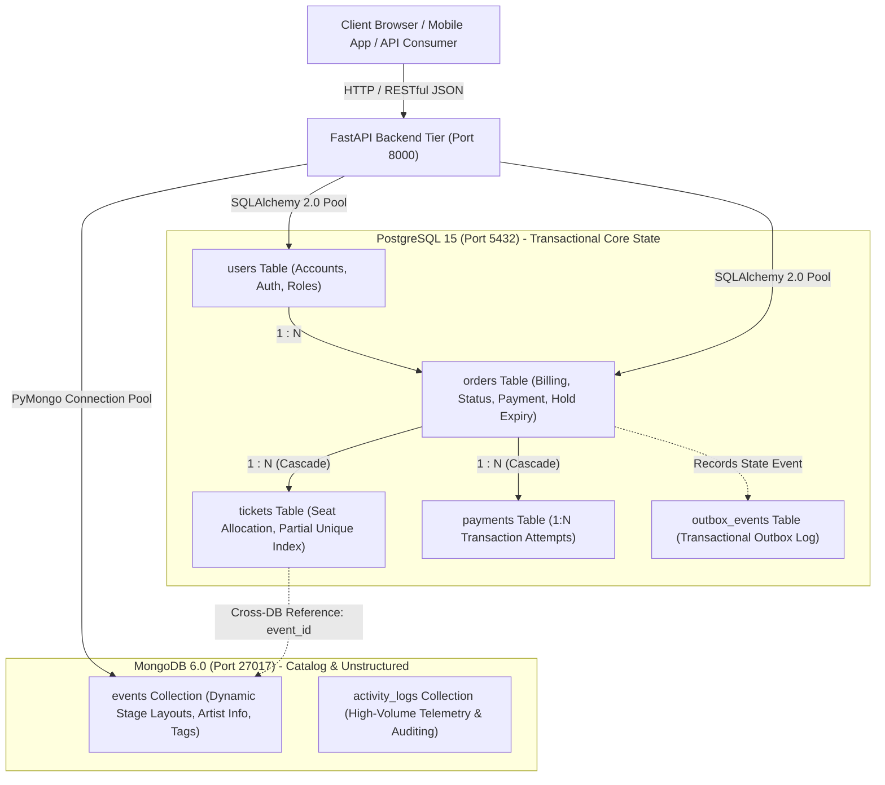
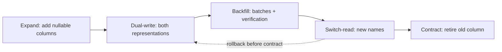

# 269340 Ticket Booking Platform — Checkpoint 1 & 2: Dual-Database Model and Zero-Downtime Migration

A high-performance, production-grade Dual-Database backend API for concert, music event, and festival ticket booking. Built with **FastAPI**, **PostgreSQL** (ACID transactional core state), and **MongoDB** (flexible event catalog & telemetry).

---

## 1. Team Roster (4)

| Student ID | Full Name | Role |
| :--- | :--- | :--- |
| **670615022** | Natthakritta Aoktan | Backend Lead & Database Architecture |
| **670615027** | Nannapat Chaipoon | API Engineering & Request Validation |
| **670615029** | Poonyaporn Intaphrom | Data Engineering & Project Manager |
| **670615032** | Pandara Yutiraksa | System Documentation & Frontend design |

---

## 2. System Architecture Diagram

```
 ┌────────────────┐
 │ Client Browser │
 └───────┬────────┘
         │ (HTTP / JSON API)
         ▼
 ┌────────────────┐
 │  Web API Tier  │
 │(FastAPI/Python)│
 └────┬──────┬────┘
      │      │ 
(Relational) │ (Document)
 ┌────┘      └────┐
 ▼                ▼
┌──────────────┐ ┌──────────────┐
│  PostgreSQL  │ │   MongoDB    │
│(Transactional│ │  (Catalog/   │
│ Core State)  │ │Unstructured) │
└──────────────┘ └──────────────┘
```

### Detailed Component Architecture



### Domain Boundary Separation:

| Database | Data | Why |
| :--- | :--- | :--- |
| **PostgreSQL** | `users`, `orders`, `tickets`, `payments`, `outbox_events` | Money and seat ownership need constraints, foreign keys and ACID transactions. |
| **MongoDB** | `events` (zones, prices, capacity, `booked_count`, nested artist and venue, free-form `dynamic_attributes`), `activity_logs` | Event documents vary in shape, and telemetry is high-volume and append-only. |

1. **PostgreSQL (Port 5432)**:
   - **Users**: Core user credentials, security hashes, and role-based access (`fan`, `organizer`, `admin`).
   - **Orders**: ACID transactional records preventing double charging and maintaining exact financial state.
   - **Tickets**: Discrete seat/zone records strictly linked to orders with unique ticket codes to prevent double-booking.
   
2. **MongoDB (Port 27017)**:
   - **Events**: Flexible JSON documents supporting heterogeneous stage zones, nested artist profiles, and arbitrary `dynamic_attributes` (age policies, stage specs, festival passes).
   - **ActivityLogs**: Append-only telemetry recording search behavior, checkout funnels, and interaction metrics.

---

## 3. Quick Start & Setup Instructions

> 📖 **Team Onboarding & Setup Guide:** For detailed member guidelines, high-availability architecture notes, and role-specific workflows, see [project-guide.md](project-guide.md).

### Prerequisites
- [Docker & Docker Compose](https://docs.docker.com/get-docker/)
- [Python 3.10+](https://www.python.org/)

### Step 1: Clone Repository & Configure Environment
```bash
git clone https://github.com/RowyMonkle/269340-Pruet_WebDev.git
cd 269340-Pruet_WebDev

# Copy environment file template
cp .env.example .env
```

### Step 2: Launch Services with Docker Compose

**full stack in Docker**
```bash
docker compose up --build -d
docker compose ps                           # migrate exits 0, api / api_2 show "healthy"
docker compose exec api python seed.py      # seed both databases
```
`migrate` runs `scripts/migrate.py` (Alembic `upgrade head`) once before the API starts. Requests go through nginx on port 8000, which balances across two API replicas (`api` on 8001, `api_2` on 8002).

To ship new API code without downtime, restart the replicas one at a time:
```bash
sh scripts/rolling_deploy.sh
```

### Step 3: Open the API
- Swagger UI: http://localhost:8000/docs
- ReDoc: http://localhost:8000/redoc
- Health check: http://localhost:8000/health (`200` when both databases respond, otherwise `503`)

   ### Seed data
`seed.py` clears and refills both databases, and prints the exact totals when it finishes.
   - **PostgreSQL:** 250 users, 500 orders, and their tickets, payments and outbox events (over 1,000 rows in total). Order totals equal the sum of their ticket prices, and ticket prices and zones match the Mongo events.
   - **MongoDB:** 200 events and 1,200 activity logs (1,400 documents). Logs reference real seeded user IDs.
   - The random seed is fixed (`42`), so every run produces the same data shape.

   ### Troubleshooting
- **`role "dev_user" does not exist` or a Mongo "connection refused" error.** Something else may be using port 5432 (for example a locally installed PostgreSQL service on Windows), or an old Docker volume was created with different credentials. Stop the local service, then reset:
  ```bash
  docker compose down -v
  docker compose up -d postgres_db mongo_db
  ```
- **`init.sql` changes are not applied.** The script only runs when the Postgres volume is empty, so run `docker compose down -v` first.
- **Ports.** Postgres uses 5432, MongoDB 27017, nginx 8000 and the API replicas 8001/8002. Change the mapping in `docker-compose.yml` (and `.env`) if they are taken.

---


### Step 4: Run Automated Concurrency & Stress Tests
```bash
# Run inside Docker container (recommended):
docker compose exec api pytest tests/test_concurrency.py -v

# Or run locally if Python virtual environment is active:
pytest tests/test_concurrency.py -v
```
**Automated Test Scenarios Covered:**
1. `test_oversell_concurrency_protection`: 50 concurrent threads competing for 1 available seat. Exactly 1 order succeeds (`201`), and 49 are rejected (`409 Conflict`).
2. `test_same_seat_concurrency_protection`: 2 parallel requests trying to claim the exact same seat number. PostgreSQL partial unique index prevents double-booking (`409 Conflict`).
3. `test_idempotency_order_placement`: Repeated requests with identical `Idempotency-Key` return original order without double-booking or duplicate payments.
4. `test_idempotency_payload_mismatch`: Replaying an existing `Idempotency-Key` with altered payload parameters returns `409 Conflict`.
5. `test_paying_twice_fails_with_400`: First payment confirms order. Second payment attempt returns `400 Bad Request`.
6. `test_expiry_then_pay_fails_with_410`: Paying for an expired seat hold releases seats back to MongoDB and returns `410 Gone`.

---

## 4. API Endpoints Summary

| Method | Route | Target DB | Status | Description |
| :--- | :--- | :--- | :--- | :--- |
| `GET` | `/health` | Both | `200` / `503` | Verifies live connectivity to PostgreSQL and MongoDB |
| `POST` | `/api/v1/users` | PostgreSQL | `201`, `400`, `409` | Register user account (strictly forces fan role, hashes password) |
| `GET` | `/api/v1/users/{id}` | PostgreSQL | `200`, `404` | Fetch user details via `.options(load_only(...))` projection |
| `GET` | `/api/v1/users` | PostgreSQL | `200` | Paginated list of users (optimized projection, zero N+1 queries) |
| `GET` | `/api/v1/events` | MongoDB | `200` | Fetch paginated concert/festival catalog with field projections |
| `POST` | `/api/v1/events` | MongoDB | `201`, `400` | Create event document with nested dynamic attributes |
| `GET` | `/api/v1/events/{id}` | MongoDB | `200`, `404` | Fetch single event document by its ObjectId |
| `GET` | `/api/v1/products` | MongoDB | `200` | Catalog alias for /events |
| `POST` | `/api/v1/products` | MongoDB | `201` | Catalog alias for /events |
| `POST` | `/api/v1/orders` | Dual-DB | `201`, `400`, `409` | Atomic checkout with 10-min seat hold, `Idempotency-Key` header support |
| `GET` | `/api/v1/orders/{id}`| PostgreSQL | `200`, `404` | Fetch order details with associated tickets and payments (joinedload) |
| `POST` | `/api/v1/orders/{id}/payments` | PostgreSQL | `201`, `400` | Process payment, confirm order, activate tickets (`held` $\rightarrow$ `valid`) |
| `GET` | `/api/v1/orders/{id}/payments` | PostgreSQL | `200`, `404` | List payment transaction attempts for an order |
| `POST` | `/api/v1/orders/cleanup-expired` | Dual-DB | `200` | Reconcile and release expired seat holds back to MongoDB |

---

## 5. Architectural Directives & Patterns

### 1. Seat Holds & Expiry State Machine
Orders follow an industry-standard state machine:
$$\text{Pending (Held)} \xrightarrow{\text{Payment Complete}} \text{Confirmed (Valid)} \quad \Big| \quad \text{Pending (Held)} \xrightarrow{\text{10 min Timeout}} \text{Expired (Released)}$$
- During the 10-minute hold window, tickets are marked `held`.
- The PostgreSQL partial unique index `uq_tickets_event_zone_seat` protects seats in both `held` and `valid` states from double-booking.
- Background reconciliation automatically releases expired seats back to the MongoDB event capacity.

### 2. Transactional Outbox Pattern (Dual-DB Consistency)
To guarantee eventual consistency across PostgreSQL and MongoDB:
- Every state change writes an atomic event (`SEAT_HELD`, `ORDER_PAID`, `SEAT_HOLD_EXPIRED`) into the PostgreSQL `outbox_events` table within the same database transaction.
- An asynchronous worker processes outbox records to update MongoDB, ensuring network failures or crashes never leave the databases permanently out of sync.

### 3. Database Projections & Eliminating N+1 Bottlenecks
- **SQLAlchemy (PostgreSQL)**: All entity queries utilize `.options(load_only(...))` including `updated_at` so heavy or sensitive columns (e.g. `hashed_password`) are never loaded into memory, and no secondary lazy-load queries are triggered. Related ticket collections use `joinedload` to prevent N+1 query loops.
- **PyMongo (MongoDB)**: All collection queries use projection dictionaries (e.g. `{"_id": 1, "title": 1, "zones": 1, ...}`) to eliminate document over-fetching over the wire.

### 4. Zero-Downtime Schema Evolution (Expand and Contract Pattern)
Use staged schema changes to reduce disruption; DDL can still acquire table locks. The intended workflow is:
1. **Expand**: Add new columns with `nullable=True` or safe default values alongside legacy fields.
2. **Dual Write**: API writes to both legacy and new schema versions concurrently.
3. **Backfill**: Background worker asynchronously migrates legacy records.
4. **Switch Read**: Read traffic shifts from old columns to new columns.
5. **Contract**: Safely drop deprecated columns only after previous application versions are fully decommissioned.

### 5. Git Hygiene & Security
- Strict `.gitignore` prevents tracking virtual environments (`.venv`), `.env` configuration files, database files (`*.db`, `*.sqlite`), and credentials.
- Pure ORM queries and parameterized SQL prevent SQL Injection vulnerabilities.


## 6. Pandara — CP2 documentation & test client

Open **http://localhost:8000/test-client/** after updating the running API replicas:

```bash
# Rebuild the shared image, then update replicas one at a time
docker compose build migrate
docker compose up -d --no-deps --wait api
# Allow nginx DNS cache to refresh before updating the second replica
sleep 6
docker compose up -d --no-deps --wait api_2
curl --fail http://localhost:8000/health
```

This local test client creates real test users, shows the request (password redacted),
reports HTTP errors, and lists the first ten users. It reads `UserCreate` from
`/openapi.json`: the split-name option is enabled only when the API explicitly
advertises both `first_name` and `last_name`; the current API accepts both shapes
(`full_name` or `first_name` / `last_name`) on `POST /api/v1/users` and `PUT /api/v1/users/{id}`.
Adding database columns does **not** automatically change the API contract.

### Expand–Contract: five phases and current implementation

The change under preparation is `users.full_name` → `first_name` + `last_name`.
The five phases below describe the intended process, not a claim that all phases
are implemented. Source of truth: Alembic revisions, `user_service.py`, and
`schemas/user.py` in this checkout.

| Phase | Action and exit condition | Current checkout |
| --- | --- | --- |
| 1. Expand | Add nullable new columns, retain old column; confirm migration revision and index. | Implemented by `0004_expand_user_names`. |
| 2. Dual-write | Write both old and new fields; confirm both are populated for new requests on every replica. | `POST` and `PUT /users` follow flag `user_name_write_mode` (`legacy` / `dual` / `new`). |
| 3. Backfill | Fill old rows in bounded, resumable batches; verify no missing names and agree on name-splitting rules. | `scripts/backfill.py`: cursor batches of 50, checkpoint in `backfill_checkpoints`, `SKIP LOCKED`, only fills NULL columns. |
| 4. Switch-read | Read new fields while preserving the agreed public response; verify old/new clients under traffic and keep rollback available. | `GET /users` follows flag `user_name_read_source` (`legacy` / `new`); the response shape is the same either way. |
| 5. Contract | Stop legacy writes, remove all legacy dependencies, then remove the old column in a reviewed revision. | `0005_contract_user_full_name`: refuses to run unless both flags are `new` and no user lacks `first_name` / `last_name`. Not applied by `docker compose up`. |



`ALTER TABLE` still acquires locks. Nullable columns avoid a table rewrite here;
`lock_timeout = '3s'` limits waiting, and `CREATE INDEX CONCURRENTLY` reduces
write blocking during index creation. These measures are not an unconditional
zero-downtime guarantee: measure real requests while applying the change.

### Commands (full 5-phase run)

Run from the repository root, with Docker Desktop running. Flag changes reach both
replicas within `FLAG_CACHE_SECONDS` (2 s).

```bash
# Phase 1 Expand: applied by compose (migrate stops at 0004 on purpose, never at "head")
docker compose up --build -d
docker compose exec api alembic current                       # 0004_expand_user_names
docker compose exec api python seed.py --users 5000   # more rows make the backfill run many batches

# Baseline + snapshot of existing users, then start the load (leave it running)
docker compose exec api python scripts/verify_migration.py --stage before-backfill --save-snapshot /tmp/snap.json
docker compose run --rm --no-deps api python scripts/traffic_gen.py --base-url http://nginx/api/v1 --duration 240

# Phase 2 Dual-write
curl -X PUT http://localhost:8000/api/v1/admin/flags/user_name_write_mode -H 'X-Admin-Token: dev-admin-token' -H 'Content-Type: application/json' -d '{"value":"dual"}'

# Phase 3 Backfill (resumable; --dry-run only counts)
docker compose exec api python scripts/backfill.py --dry-run
docker compose exec api python scripts/backfill.py
docker compose exec api python scripts/verify_migration.py --stage after-backfill --compare-snapshot /tmp/snap.json

# Phase 4 Switch-read, then stop writing the legacy column
curl -X PUT http://localhost:8000/api/v1/admin/flags/user_name_read_source -H 'X-Admin-Token: dev-admin-token' -H 'Content-Type: application/json' -d '{"value":"new"}'
curl -X PUT http://localhost:8000/api/v1/admin/flags/user_name_write_mode -H 'X-Admin-Token: dev-admin-token' -H 'Content-Type: application/json' -d '{"value":"new"}'

# Phase 5 Contract: drops users.full_name. Refuses unless both flags are "new" and every user is migrated
docker compose exec api alembic upgrade 0005_contract_user_full_name
docker compose exec api python scripts/verify_migration.py --stage after-contract --compare-snapshot /tmp/snap.json

# Rollback of the contract (re-adds and refills full_name)
docker compose exec api alembic downgrade 0004_expand_user_names

# Inspect flags
curl --fail http://localhost:8000/api/v1/admin/flags -H 'X-Admin-Token: dev-admin-token'
```

Run the traffic generator in its own container (`run --rm`), not with `exec` inside a replica, so restarting
a replica (`sh scripts/rolling_deploy.sh`) never kills the load. `traffic_gen.py` exits non-zero if it sees any 5xx, connection failure, unexpected 4xx,
inconsistent name, p99 >= 500 ms or fewer than 20 req/s, and prints a PASS/FAIL report.

To rehearse on a second copy without touching your dev stack, set the variables listed at the top of
`docker-compose.yml` (`STACK_PREFIX`, `NGINX_PORT`, `PG_VOLUME`, ...) and add `-p rehearsal` to every `docker compose` command.

Never run `alembic upgrade head` during the demo: it would apply the contract revision.
Do not run a downgrade or delete volumes on a database you want to keep; rehearse on a
disposable setup.
