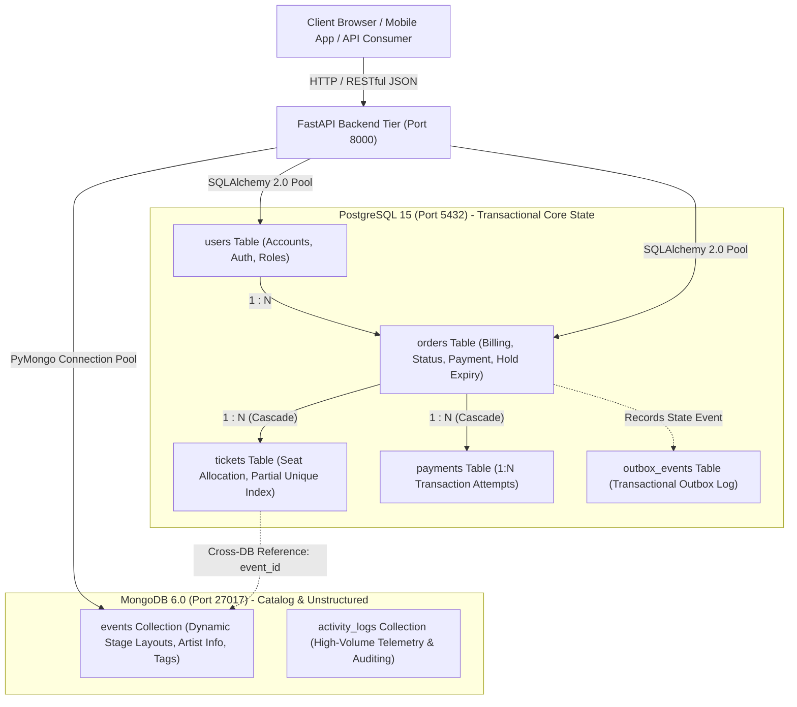
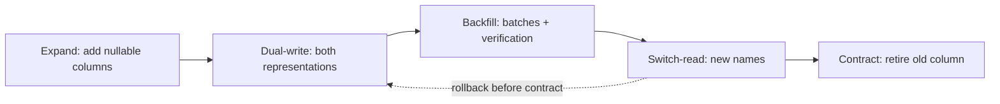
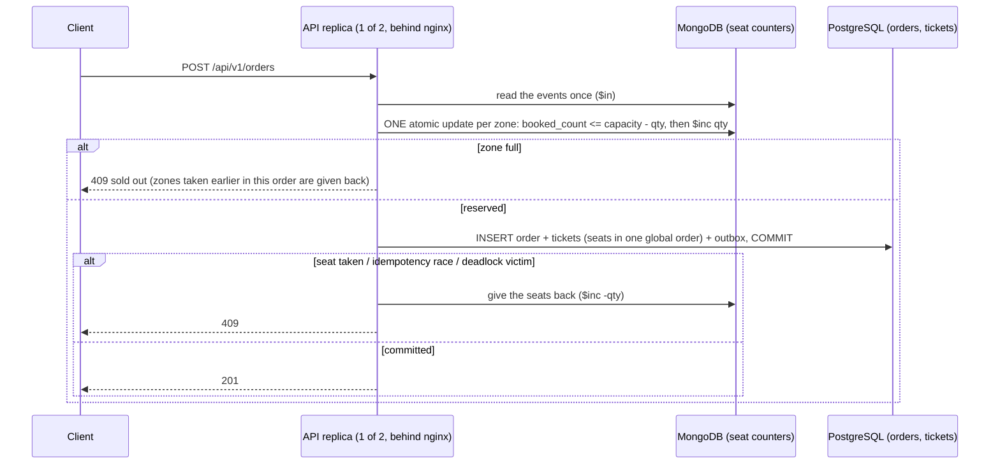

# 269340 Ticket Booking Platform — Checkpoints 1-3: Dual-Database Model, Zero-Downtime Migration, Concurrency & Performance

A high-performance, production-grade Dual-Database backend API for concert, music event, and festival ticket booking. Built with **FastAPI**, **PostgreSQL** (ACID transactional core state), and **MongoDB** (flexible event catalog & telemetry).

---

## 1. Team Roster (4)

| Student ID | Full Name | Role |
| :--- | :--- | :--- |
| **670615022** | Natthakritta Aoktan | Backend Lead & Database Architecture |
| **670615027** | Nannapat Chaipoon | API Engineering & Request Validation |
| **670615029** | Poonyaporn Intaphrom | Data Engineering & Project Manager |
| **670615032** | Pandara Yutiraksa | System Documentation & Frontend design |

---

## 2. System Architecture Diagram

```
 ┌────────────────┐
 │ Client Browser │
 └───────┬────────┘
         │ (HTTP / JSON API)
         ▼
 ┌────────────────┐
 │  Web API Tier  │
 │(FastAPI/Python)│
 └────┬──────┬────┘
      │      │ 
(Relational) │ (Document)
 ┌────┘      └────┐
 ▼                ▼
┌──────────────┐ ┌──────────────┐
│  PostgreSQL  │ │   MongoDB    │
│(Transactional│ │  (Catalog/   │
│ Core State)  │ │Unstructured) │
└──────────────┘ └──────────────┘
```

### Detailed Component Architecture



### Domain Boundary Separation:

| Database | Data | Why |
| :--- | :--- | :--- |
| **PostgreSQL** | `users`, `orders`, `tickets`, `payments`, `outbox_events` | Money and seat ownership need constraints, foreign keys and ACID transactions. |
| **MongoDB** | `events` (zones, prices, capacity, `booked_count`, nested artist and venue, free-form `dynamic_attributes`), `activity_logs` | Event documents vary in shape, and telemetry is high-volume and append-only. |

1. **PostgreSQL (Port 5432)**:
   - **Users**: Core user credentials, security hashes, and role-based access (`fan`, `organizer`, `admin`).
   - **Orders**: ACID transactional records preventing double charging and maintaining exact financial state.
   - **Tickets**: Discrete seat/zone records strictly linked to orders with unique ticket codes to prevent double-booking.
   
2. **MongoDB (Port 27017)**:
   - **Events**: Flexible JSON documents supporting heterogeneous stage zones, nested artist profiles, and arbitrary `dynamic_attributes` (age policies, stage specs, festival passes).
   - **ActivityLogs**: Append-only telemetry recording search behavior, checkout funnels, and interaction metrics.

---

## 3. Quick Start & Setup Instructions

> 📖 **Team Onboarding & Setup Guide:** For detailed member guidelines, high-availability architecture notes, and role-specific workflows, see [project-guide.md](project-guide.md).

### Prerequisites
- [Docker & Docker Compose](https://docs.docker.com/get-docker/)
- [Python 3.10+](https://www.python.org/)

### Step 1: Clone Repository & Configure Environment
```bash
git clone https://github.com/RowyMonkle/269340-Pruet_WebDev.git
cd 269340-Pruet_WebDev

# Copy environment file template
cp .env.example .env
```

### Step 2: Launch Services with Docker Compose

**full stack in Docker**
```bash
docker compose up --build -d
docker compose ps                           # migrate exits 0, api / api_2 show "healthy"
docker compose exec api python seed.py      # seed both databases
```
`migrate` runs `scripts/migrate.py` (Alembic, up to `0008_drop_redundant_indexes`; the CP2 contract revision is never applied automatically) once before the API starts. Requests go through nginx on port 8000, which balances across two API replicas (`api` on 8001, `api_2` on 8002).

To ship new API code without downtime, restart the replicas one at a time:
```bash
sh scripts/rolling_deploy.sh
```

### Step 3: Open the API
- Swagger UI: http://localhost:8000/docs
- ReDoc: http://localhost:8000/redoc
- Health check: http://localhost:8000/health (`200` when both databases respond, otherwise `503`)

   ### Seed data
`seed.py` clears and refills both databases, and prints the exact totals when it finishes.
   - **PostgreSQL:** 250 users, 500 orders, and their tickets, payments and outbox events (over 1,000 rows in total). Order totals equal the sum of their ticket prices, and ticket prices and zones match the Mongo events.
   - **MongoDB:** 200 events and 1,200 activity logs (1,400 documents). Logs reference real seeded user IDs.
   - The random seed is fixed (`42`), so every run produces the same data shape.

   ### Troubleshooting
- **`role "dev_user" does not exist` or a Mongo "connection refused" error.** Something else may be using port 5432 (for example a locally installed PostgreSQL service on Windows), or an old Docker volume was created with different credentials. Stop the local service, then reset:
  ```bash
  docker compose down -v
  docker compose up -d postgres_db mongo_db
  ```
- **`init.sql` changes are not applied.** The script only runs when the Postgres volume is empty, so run `docker compose down -v` first.
- **Ports.** Postgres uses 5432, MongoDB 27017, nginx 8000 and the API replicas 8001/8002. Change the mapping in `docker-compose.yml` (and `.env`) if they are taken.

---


### Step 4: Run Automated Concurrency Tests
```bash
# every test, with no silent skips (REQUIRE_DB=1 fails instead of skipping when a database is down)
docker compose exec -e REQUIRE_DB=1 api pytest tests -q

# the concurrency proof for CP3 (in-process), and the same races through nginx and both API replicas
docker compose exec -e REQUIRE_DB=1 api pytest tests/test_concurrency.py -v -s
docker compose exec -e API_URL=http://nginx -e REQUIRE_DB=1 api pytest tests/test_concurrency.py -v -s
```
`tests/test_concurrency.py` holds 20 tests: the six original ones (50 buyers for the last seat, same seat twice, idempotency replay and mismatch, paying twice, paying after expiry)
plus the CP3 races (20 users for the last ticket, 20 parallel payments, 20 identical idempotency keys, opposite-order seat bookings, pay vs expiry vs sweeper, concurrent profile updates and more).
What each one proves, and which mechanism it protects, is listed in [section 7.2](#72-how-the-system-prevents-races).

---

## 4. API Endpoints Summary

| Method | Route | Target DB | Status | Description |
| :--- | :--- | :--- | :--- | :--- |
| `GET` | `/health` | Both | `200` / `503` | Verifies live connectivity to PostgreSQL and MongoDB |
| `POST` | `/api/v1/users` | PostgreSQL | `201`, `400`, `409` | Register user account (strictly forces fan role, hashes password) |
| `GET` | `/api/v1/users/{id}` | PostgreSQL | `200`, `404` | Fetch user details via `.options(load_only(...))` projection |
| `GET` | `/api/v1/users` | PostgreSQL | `200` | Paginated list of users (optimized projection, zero N+1 queries) |
| `GET` | `/api/v1/events` | MongoDB | `200`, `503` | Paginated catalog of event **summaries** (title, artist and venue names, date, status, `min_price`, `seats_left`), computed inside MongoDB; the full document is `GET /events/{id}` |
| `POST` | `/api/v1/events` | MongoDB | `201`, `400` | Create event document with nested dynamic attributes |
| `GET` | `/api/v1/events/{id}` | MongoDB | `200`, `404` | Fetch single event document by its ObjectId |
| `GET` | `/api/v1/products` | MongoDB | `200`, `503` | Catalog alias for /events (same summaries) |
| `POST` | `/api/v1/products` | MongoDB | `201` | Catalog alias for /events |
| `POST` | `/api/v1/orders` | Dual-DB | `201`, `400`, `404`, `409`, `503` | Atomic checkout with 10-min seat hold, `Idempotency-Key` header support |
| `GET` | `/api/v1/orders/summary?user_id=&limit=&offset=` | PostgreSQL | `200`, `404` | Newest-first order summaries with `ticket_count` and `paid_amount` computed in SQL, paginated |
| `GET` | `/api/v1/orders/{id}/summary` | PostgreSQL | `200`, `404` | One order summary without tickets or payments |
| `GET` | `/api/v1/orders/{id}`| PostgreSQL | `200`, `404` | Fetch order details with associated tickets and payments (joinedload) |
| `POST` | `/api/v1/orders/{id}/payments` | PostgreSQL | `201`, `400`, `404`, `409`, `410`, `503` | Process payment, confirm order, activate tickets (`held` $\rightarrow$ `valid`); `409` already paid / cancelled, `410` hold expired |
| `POST` | `/api/v1/payments` | PostgreSQL | `201`, `400`, `404`, `409`, `410`, `503` | The same operation, locks and errors as `POST /orders/{id}/payments`, with the order id in the body: `{"order_id", "amount", "provider"}` (`payment_method` is accepted as another name for `provider`). For clients that cannot template a path, such as k6 |
| `GET` | `/api/v1/orders/{id}/payments` | PostgreSQL | `200`, `404` | List payment transaction attempts for an order |
| `POST` | `/api/v1/orders/cleanup-expired` | Dual-DB | `200` | **Internal**: nginx answers `404`, not in Swagger. The background worker runs it every 15 s on every replica |

`409` means the request collided with a concurrent update and nothing was changed: retry. `503` means the database is busy or unreachable and nothing was changed: retry after the `Retry-After` header (2 s).

---

## 5. Architectural Directives & Patterns

### 1. Seat Holds & Expiry State Machine
Orders follow an industry-standard state machine:
$$\text{Pending (Held)} \xrightarrow{\text{Payment Complete}} \text{Confirmed (Valid)} \quad \Big| \quad \text{Pending (Held)} \xrightarrow{\text{10 min Timeout}} \text{Expired (Released)}$$
- During the 10-minute hold window, tickets are marked `held`.
- The PostgreSQL partial unique index `uq_tickets_event_zone_seat` protects seats in both `held` and `valid` states from double-booking.
- Background reconciliation automatically releases expired seats back to the MongoDB event capacity.

### 2. Transactional Outbox Pattern (Dual-DB Consistency)
To guarantee eventual consistency across PostgreSQL and MongoDB:
- Every state change writes an atomic event (`SEAT_HELD`, `ORDER_PAID`, `SEAT_HOLD_EXPIRED`) into the PostgreSQL `outbox_events` table within the same database transaction.
- An asynchronous worker processes outbox records to update MongoDB, ensuring network failures or crashes never leave the databases permanently out of sync.

### 3. Database Projections & Eliminating N+1 Bottlenecks
- **SQLAlchemy (PostgreSQL)**: the user endpoints select only the columns they return (`load_only(...)`, never `hashed_password`), and every list endpoint runs a constant number of statements (measured in section 7.7, no N+1).
  The orders list still loads whole entities with `joinedload` and is not paginated; turning it into a projection is a CP3 task (section 7.6).
- **PyMongo (MongoDB)**: queries use projection dictionaries (e.g. `{"_id": 1, "title": 1, "zones": 1, ...}`); the catalog list still returns whole documents (CP3 task, section 7.6).

### 4. Zero-Downtime Schema Evolution (Expand and Contract Pattern)
Use staged schema changes to reduce disruption; DDL can still acquire table locks. The intended workflow is:
1. **Expand**: Add new columns with `nullable=True` or safe default values alongside legacy fields.
2. **Dual Write**: API writes to both legacy and new schema versions concurrently.
3. **Backfill**: Background worker asynchronously migrates legacy records.
4. **Switch Read**: Read traffic shifts from old columns to new columns.
5. **Contract**: Safely drop deprecated columns only after previous application versions are fully decommissioned.

### 5. Git Hygiene & Security
- Strict `.gitignore` prevents tracking virtual environments (`.venv`), `.env` configuration files, database files (`*.db`, `*.sqlite`), and credentials.
- Pure ORM queries and parameterized SQL prevent SQL Injection vulnerabilities.


## 6. Pandara — CP2 documentation & test client

Open **http://localhost:8000/test-client/** after updating the running API replicas:

```bash
# Rebuild the shared image, then update replicas one at a time
docker compose build migrate
docker compose up -d --no-deps --wait api
# Allow nginx DNS cache to refresh before updating the second replica
sleep 6
docker compose up -d --no-deps --wait api_2
curl --fail http://localhost:8000/health
```

This local test client creates real test users, shows the request (password redacted),
reports HTTP errors, and lists the first ten users. It reads `UserCreate` from
`/openapi.json`: the split-name option is enabled only when the API explicitly
advertises both `first_name` and `last_name`; the current API accepts both shapes
(`full_name` or `first_name` / `last_name`) on `POST /api/v1/users` and `PUT /api/v1/users/{id}`.
Adding database columns does **not** automatically change the API contract.

### Expand–Contract: five phases and current implementation

The change under preparation is `users.full_name` → `first_name` + `last_name`.
The five phases below describe the intended process, not a claim that all phases
are implemented. Source of truth: Alembic revisions, `user_service.py`, and
`schemas/user.py` in this checkout.

| Phase | Action and exit condition | Current checkout |
| --- | --- | --- |
| 1. Expand | Add nullable new columns, retain old column; confirm migration revision and index. | Implemented by `0004_expand_user_names`. |
| 2. Dual-write | Write both old and new fields; confirm both are populated for new requests on every replica. | `POST` and `PUT /users` follow flag `user_name_write_mode` (`legacy` / `dual` / `new`). |
| 3. Backfill | Fill old rows in bounded, resumable batches; verify no missing names and agree on name-splitting rules. | `scripts/backfill.py`: cursor batches of 50, checkpoint in `backfill_checkpoints`, `SKIP LOCKED`, only fills NULL columns. |
| 4. Switch-read | Read new fields while preserving the agreed public response; verify old/new clients under traffic and keep rollback available. | `GET /users` follows flag `user_name_read_source` (`legacy` / `new`); the response shape is the same either way. |
| 5. Contract | Stop legacy writes, remove all legacy dependencies, then remove the old column in a reviewed revision. | `0005_contract_user_full_name`: refuses to run unless both flags are `new` and no user lacks `first_name` / `last_name`. Not applied by `docker compose up`. |



`ALTER TABLE` still acquires locks. Nullable columns avoid a table rewrite here;
`lock_timeout = '3s'` limits waiting, and `CREATE INDEX CONCURRENTLY` reduces
write blocking during index creation. These measures are not an unconditional
zero-downtime guarantee: measure real requests while applying the change.

### Commands (full 5-phase run)

Run from the repository root, with Docker Desktop running. Flag changes reach both
replicas within `FLAG_CACHE_SECONDS` (2 s).

```bash
# Phase 1 Expand: applied by compose (migrate stops at 0008 on purpose, never at "head", and never applies 0005)
docker compose up --build -d
docker compose exec api alembic current                       # 0008_drop_redundant_indexes (head); 0004 is its ancestor
docker compose exec api python seed.py --users 5000   # more rows make the backfill run many batches

# Baseline + snapshot of existing users, then start the load (leave it running)
docker compose exec api python scripts/verify_migration.py --stage before-backfill --save-snapshot /tmp/snap.json
docker compose run --rm --no-deps api python scripts/traffic_gen.py --base-url http://nginx/api/v1 --duration 240

# Phase 2 Dual-write
curl -X PUT http://localhost:8000/api/v1/admin/flags/user_name_write_mode -H 'X-Admin-Token: dev-admin-token' -H 'Content-Type: application/json' -d '{"value":"dual"}'

# Phase 3 Backfill (resumable; --dry-run only counts)
docker compose exec api python scripts/backfill.py --dry-run
docker compose exec api python scripts/backfill.py
docker compose exec api python scripts/verify_migration.py --stage after-backfill --compare-snapshot /tmp/snap.json

# Phase 4 Switch-read, then stop writing the legacy column
curl -X PUT http://localhost:8000/api/v1/admin/flags/user_name_read_source -H 'X-Admin-Token: dev-admin-token' -H 'Content-Type: application/json' -d '{"value":"new"}'
curl -X PUT http://localhost:8000/api/v1/admin/flags/user_name_write_mode -H 'X-Admin-Token: dev-admin-token' -H 'Content-Type: application/json' -d '{"value":"new"}'

# Phase 5 Contract: drops users.full_name. Refuses unless both flags are "new" and every user is migrated
docker compose exec api alembic upgrade 0005_contract_user_full_name
docker compose exec api python scripts/verify_migration.py --stage after-contract --compare-snapshot /tmp/snap.json

# Rollback of the contract only (re-adds and refills full_name, keeps the CP3 index)
docker compose exec api alembic downgrade 0005_contract_user_full_name@-1

# Inspect flags
curl --fail http://localhost:8000/api/v1/admin/flags -H 'X-Admin-Token: dev-admin-token'
```

Run the traffic generator in its own container (`run --rm`), not with `exec` inside a replica, so restarting
a replica (`sh scripts/rolling_deploy.sh`) never kills the load. `traffic_gen.py` exits non-zero if it sees any 5xx, connection failure, unexpected 4xx,
inconsistent name, p99 >= 500 ms or fewer than 20 req/s, and prints a PASS/FAIL report.

To rehearse on a second copy without touching your dev stack, set the variables listed at the top of
`docker-compose.yml` (`STACK_PREFIX`, `NGINX_PORT`, `PG_VOLUME`, ...) and add `-p rehearsal` to every `docker compose` command.

The migration history has two heads on purpose (0005 contract, 0006-0008 CP3: list index, database guards, index review), so `alembic upgrade head` refuses to run and nobody can apply the contract by accident; name the revision you want.
Do not run a downgrade or delete volumes on a database you want to keep; rehearse on a
disposable setup.


## 7. CP3 — Concurrency Control & Performance Audit (Week 16, 40% of the team grade)

Written by Natthakritta (Backend Lead & Database Architecture) so that the four of us build the rest on **the same design**.
Everything marked **Done** is in the repository and was verified on a clean stack (numbers in 7.7). Everything marked **TODO**
has an owner, file names and an acceptance test in 7.6.

### 7.1 What CP3 asks for and where we stand

| Pts | Requirement (CP3 spec) | Owner | Status |
| ---: | --- | --- | --- |
| 35 | Concurrency control (optimistic **or** pessimistic) proven by `test_concurrency.py` | Natthakritta | **Done.** Pessimistic locking + atomic seat counters, `test_concurrency.py` (22 tests), a limit on every wait (7.2, 7.3, 7.9) |
| 35 | Query projection and zero N+1 on list endpoints | Nannapat (endpoints), Natthakritta (index, DB statistics) | DB side **Done**. Order summaries: `GET /orders/summary` (section 4). Open items for the list endpoints: 7.6 |
| 20 | Load test: >= 50 VUs, 3 min, p95 < 200 ms, p99 < 500 ms, errors < 1 % | Poonyaporn | **TODO.** The backend already passes a throwaway profile (7.7) |
| 10 | `Performance_Audit_Report.pdf` (or a README section) + defence | Pandara (report), everyone (defence) | **TODO** |

Team decisions (2026-10-13): **Option B (pessimistic)** is our concurrency answer, Option A (version column / 412) is not built.
Load tool: **Locust**. `pg_stat_statements` is enabled for database-side evidence.

### 7.2 How the system prevents races

Every write that two users can attempt at the same time is protected by one mechanism chosen per resource:



| Shared resource | Race | Mechanism | Code | Proof (tests/test_concurrency.py) |
| --- | --- | --- | --- | --- |
| Seat counter of a zone (MongoDB `zones[].booked_count`) | many buyers, last seats | one atomic conditional update per (event, zone) for the whole quantity: lock-free compare-and-set, all-or-nothing | `order_service.create_order_dual_db` step 4 | `test_oversell_concurrency_protection`, `test_last_ticket_20_users`, `test_multi_ticket_orders_never_oversell`, `test_sold_out_second_zone_returns_the_first_zones_seats` |
| One seat (PostgreSQL `tickets`) | two buyers, same seat | partial unique index `uq_tickets_event_zone_seat`; event ids canonicalised; seats inserted in one global order | `sql_models.Ticket`, `order_service` | `test_same_seat_concurrency_protection`, `test_event_id_spelling_cannot_bypass_the_seat_lock`, `test_every_order_inserts_its_seats_in_one_global_order`, `test_opposite_order_multi_seat_bookings_never_return_5xx` |
| An order (`orders` row) | double payment; pay vs expiry vs sweeper | **pessimistic lock** `SELECT ... FOR UPDATE` on the order row; sweeper and outbox worker use `SKIP LOCKED` | `payment_service.process_order_payment`, `order_service.cleanup_expired_seat_holds`, `outbox_worker` | `test_paying_twice_fails_with_400`, `test_parallel_payments_charge_the_order_once`, `test_pay_vs_expiry_vs_cleanup_race_releases_each_seat_once`, `test_parallel_cleanup_releases_each_hold_once` |
| A retried request | the same request twice or 20 times at once | unique `Idempotency-Key` plus a fingerprint of user, event, zone | `order_service` | `test_idempotency_order_placement`, `test_idempotency_payload_mismatch`, `test_parallel_same_idempotency_key_creates_one_order`, `test_idempotent_replay_works_with_any_zone_spelling` |
| A user row | read-modify-write of names / e-mail | `SELECT ... FOR UPDATE` in `PUT /users/{id}`; unique e-mail answers 409 | `user_service.update_user` | `test_concurrent_user_updates_do_not_lose_each_other` |
| Anything that still collides | PostgreSQL aborts one side (deadlock, serialization failure) or a lock wait runs past `lock_timeout` (5 s) | answered **409**, seats given back, never 500 | `app/core/db_errors.py`, handler in `app/main.py` | `test_database_deadlock_is_answered_with_409_and_seats_are_returned`, `tests/test_db_errors.py`, `test_a_stuck_row_lock_answers_409_after_lock_timeout_and_frees_the_request` |

**Rules every new write path must follow**

1. **Take locks in one global order.** Booking sorts seats by (event, zone, seat). Anything that locks or inserts several rows must sort them first.
   Why: before the fix, two users booking the same seats in opposite order got HTTP 500 `DeadlockDetected` in 13 % (2 seats) to 61 % (30 seats) of the rounds when the requests hit the two replicas (7.7).
2. **Spell an identifier one way before it becomes a key.** Event ids are canonicalised (`str(ObjectId(x))`), zone names compare case-insensitively, seat numbers are trimmed.
   Why: an upper-case event id used to bypass the seat lock and sell one seat twice.
3. **Reserve in MongoDB first, then write PostgreSQL, and give the seats back on any failure.** A crash between the two leaves a seat that nobody holds (a lost sale), never an oversell.
   `scripts/verify_consistency.py` finds it and `--repair` fixes it.
4. **A collision is a 409 and an overload is a 503, never a 500.** Use `classify_db_error` from `app/core/db_errors.py`. The global handler turns SQLSTATE `40P01`, `40001`, `55P03` into 409 and SQLSTATE `57014` (statement timeout), `53300`, `57P03`, an exhausted connection pool and an unreachable MongoDB into 503 + `Retry-After`, for every endpoint.
5. **No query inside a per-ticket or per-row loop.** One `$in` read, one update per zone, one SELECT per list.
6. **Status codes:** a successful booking is `201` (resource created; the spec's sample script says 200), a lost race is `409`, "already paid" is `409`, an expired hold is `410`, a busy or unreachable database is `503` with `Retry-After`.
7. **Every wait has a limit** (section 7.9): a connection from the pool 5 s, a lock 5 s, a statement 15 s, MongoDB 1 s. Anything that can wait forever lets one stuck row take every endpoint down.
8. **Background work runs in a thread, in batches, with `SKIP LOCKED`.** The worker never blocks the event loop and never holds thousands of row locks in one transaction.

### 7.3 Prove it (commands)

```bash
# every test, with no silent skips (REQUIRE_DB=1 fails instead of skipping when a database is down)
docker compose exec -e REQUIRE_DB=1 api pytest tests -q

# the CP3 concurrency proof, in-process
docker compose exec -e REQUIRE_DB=1 api pytest tests/test_concurrency.py -v -s

# the same races through nginx and BOTH replicas (two real processes). Use this one in the demo.
docker compose exec -e API_URL=http://nginx -e REQUIRE_DB=1 api pytest tests/test_concurrency.py -v -s

# after any concurrency test or load test: no oversell, no lost seat, no double charge
docker compose exec api python scripts/verify_consistency.py
docker compose exec api python scripts/verify_consistency.py --repair   # resets Mongo counters from PostgreSQL; stop traffic first
```

| File | Tests | Needs | What it proves |
| --- | ---: | --- | --- |
| `tests/test_concurrency.py` | 22 | PostgreSQL + MongoDB | every row of the table in 7.2 (3 tests inspect the server process and run in-process only) |
| `tests/test_consistency.py` | 8 | PostgreSQL + MongoDB | `verify_consistency.py` passes on honest data and catches drift, overselling, double charge, dead orders |
| `tests/test_query_counts.py` | 20 | PostgreSQL + MongoDB | section 7.10: round trips stay constant while the data grows (no N+1), payloads bounded; the counter is tested too |
| `tests/test_resilience.py` | 24 | PostgreSQL + MongoDB | section 7.9: a stuck lock, a busy pool, a dead MongoDB, the sweeper, the outbox, the worker, nginx (real mechanisms, not faked errors) |
| `tests/test_db_errors.py` | 16 | none | SQLSTATE and driver errors to HTTP 409 / 503 mapping |
| `tests/test_users_api.py`, `test_user_migration.py`, `test_cp2_scripts.py` | 61 | mostly none | CP2 (dual-write, backfill, traffic generator) |

In total 151 tests: 149 pass in-process, 1 more runs only through nginx (`API_URL=http://nginx`) and 1 is a documented `xfail` (7.10).

`tests/support.py` holds the helpers (client, users and events factory, parallel runner, cleanup). New tests should use it.
`python tests/test_concurrency.py` runs the concurrency file as a script, like the example in the spec.

`verify_consistency.py` checks, for the whole database: duplicate active seats, more than one completed payment per order, confirmed orders without payment,
payment and ticket totals, expired orders that still hold seats, ticket/order state mismatches, and per zone: negative or over-capacity counters and
drift between the MongoDB counter and the PostgreSQL ticket count. It exits with 1 if anything fails.

### 7.4 Database layer you can rely on (Done)

**Migration history has two heads on purpose.**

```
0001 -> 0002 -> 0003 -> 0004 -+- 0005_contract_user_full_name   manual, destructive (CP2 Phase 5)
                              +- 0006_orders_list_index         applied by compose / scripts/migrate.py
                                   -> 0007_db_guards            (7.11) double charge and impossible states refused by the database
                                   -> 0008_drop_redundant_indexes (7.12) nine indexes removed, measured
```

* `docker compose up` runs `scripts/migrate.py`, which goes to `0008_drop_redundant_indexes`: it applies everything except the contract.
* `alembic current` shows `0008_drop_redundant_indexes (head)`, and also `0005_contract_user_full_name (head)` after the contract was applied.
* `alembic upgrade head` refuses ("multiple heads"). Name the revision: `alembic upgrade 0005_contract_user_full_name`.
* Roll back only the contract with `alembic downgrade 0005_contract_user_full_name@-1`; `alembic downgrade 0004_expand_user_names` removes both.
* A new safe revision chains after 0008 (`alembic revision -m "..." --head 0008_drop_redundant_indexes`) and `DEFAULT_TARGET` in `scripts/migrate.py` moves to it.

**`idx_orders_user_created (user_id, created_at DESC, id DESC)`** serves "this user's newest orders, one page at a time" with no sort step and a stable page order.
Measured with `EXPLAIN (ANALYZE, BUFFERS)` on 302,505 orders, first page of 20 rows:

| User | Without the index | With the index |
| --- | --- | --- |
| 50 orders | 1.30 ms, 58 buffers, top-N sort | 0.56 ms, 23 buffers, no sort |
| 50,000 orders | 3.16 ms, 1,989 buffers (the planner scanned the wrong index) | 0.53 ms, 23 buffers |

**`pg_stat_statements`** is preloaded by `docker-compose.yml` (recreate the database container once: `docker compose up -d`) and created by migration 0006. Use it for database-side evidence:

```bash
docker compose exec api python scripts/pg_stats.py --reset                       # start a clean window
#  ... run the load test ...
docker compose exec api python scripts/pg_stats.py --top 15 --requests 13500     # heaviest statements, with calls per HTTP request
docker compose exec api python scripts/pg_stats.py --like "FROM orders" --csv docs/perf/pg_orders.csv
```

**Capacity** (so nobody has to guess): each replica has a PostgreSQL pool of 20 + 10 overflow (`POSTGRES_POOL_SIZE`, `POSTGRES_MAX_OVERFLOW`), a MongoDB pool of 50,
and 40 worker threads for the synchronous endpoints; PostgreSQL allows 100 connections. At 50 VUs about 25 requests are in flight per replica and no pool timeout was seen.
Beyond about 60 requests in flight (2 x 30 connections) a request waits for a connection for at most `POSTGRES_POOL_TIMEOUT` (5 s) and then gets `503` + `Retry-After`: raise the two pool variables and PostgreSQL's `max_connections`.

**Heavy scripts and the API have different limits.** The 5 s lock / 15 s statement limits protect the web API only. `seed.py` and `scripts/verify_consistency.py` call `relax_timeouts_for_scripts()` so a long statement is not cancelled; `backfill.py` and `pg_stats.py` use their own connections.

**Rehearse without touching your dev stack:** set the variables listed at the top of `docker-compose.yml` (`STACK_PREFIX`, `NGINX_PORT`, `PG_VOLUME`, ...) and add `-p rehearsal` to every `docker compose` command.

### 7.5 Design contracts for the work that is left

1. **Read endpoints return projections, never ORM entity graphs.** Select the columns you return (`db.query(Order.id, ...)` or `load_only`), count children with aggregates or correlated sub-selects, no `joinedload` in a list, no lazy-loaded relationship while serialising.
2. **One SELECT per list page plus one COUNT.** Lists use `PaginatedResponse` (`page`, `page_size` <= 100) and order orders by `created_at DESC, id DESC` (the index order).
3. **Summary vs detail.** A list item is a summary schema without nested tickets or payments. A detail endpoint may include children, still without lazy loads.
4. **No Mongo or PostgreSQL call inside a loop over tickets or rows.** Batch with `$in`, `bulk_write`, JOIN or aggregation.
5. **Errors:** collision -> 409 (`app/core/db_errors.py`), validation -> 400, missing -> 404, expired -> 410. Pool exhaustion or timeout -> 503 with `Retry-After`. A request that can be answered must never be a 500.
6. **Round trips are the budget.** `POST /orders` runs 7 SQL statements, three of them (`refresh`, lazy `tickets`, lazy `payments`) only exist to serialise the response; `POST /orders/{id}/payments` runs 6 whatever the number of tickets (it ran 11 + one per ticket before 7.10). Count with `tests/support.py: QueryCounter`, measure the database side with `pg_stats.py`.
7. **Load tests live in `loadtest/`** and use Locust; results go to `docs/perf/` (HTML report, CSV, charts). Raw scratch output goes to `loadtest/out/` (ignored by git).
8. **Counting SQL statements in a test:**

```python
from sqlalchemy import event
from app.core.database import engine

statements = []
@event.listens_for(engine, "before_cursor_execute")
def count(conn, cursor, statement, parameters, context, executemany):
    statements.append(statement)
```

### 7.6 Hand-off: what each person delivers

The checklist form of this section (order of work, who tests what, final checklist) is in [docs/cp3_handoff.md](docs/cp3_handoff.md).

**Nannapat — API Engineering & Request Validation (+ web design)**
1. `GET /api/v1/orders?user_id=` becomes a **paginated summary**: `id, order_number, status, total_amount, expires_at, created_at, ticket_count, paid_amount`, schema `OrderSummary`, envelope `PaginatedResponse`.
   No ORM entities, no `joinedload`. Reference query (tested: it uses `idx_orders_user_created`, the sub-selects run only for the rows returned, 0.8 ms for a user with 168 orders):

   ```sql
   SELECT o.id, o.order_number, o.status, o.total_amount, o.expires_at, o.created_at,
          (SELECT count(*) FROM tickets t WHERE t.order_id = o.id) AS ticket_count,
          (SELECT coalesce(sum(p.amount), 0) FROM payments p WHERE p.order_id = o.id AND p.status = 'completed') AS paid_amount
   FROM orders o WHERE o.user_id = :user_id
   ORDER BY o.created_at DESC, o.id DESC LIMIT :page_size OFFSET :offset;
   ```

   `GET /orders/{id}` stays the detail view (tickets and payments) but with projected columns and no lazy loads.
2. `GET /api/v1/events` list is a **summary** (id, title, category, artist and venue names, date_time, status, lowest price, seats left) without zones, bio, tags and `dynamic_attributes`: done as `EventSummary` (7.10), 100 events weigh 31 KB instead of 124 KB.
3. `tests/test_query_counts.py`: done (7.10). New list endpoints add a row to `READ_CASES`.
4. Trim the write path: drop the three response-only SELECTs on `POST /orders` and the four on payments (build the response from the objects you already hold); consider moving the activity-log insert to `BackgroundTasks`.
5. Errors per contract 5 in 7.5 (503 + `Retry-After` for pool timeouts). Keep the status table of 7.2.
6. Web design: a booking demo page in `frontend/` that shows what a `409` means to the user ("someone took it, pick another seat") and lists orders page by page. Coordinate with Pandara.
*Done when:* the new tests pass, `pytest tests` is green, and `pg_stats.py` shows one statement per list request.

**Poonyaporn — Data Engineering**
1. `loadtest/locustfile.py` with the profile below. The run must exit with code 1 when a threshold is broken (set `environment.process_exit_code` in an `events.quitting` listener).
   * 50 users, ramp 10/s, **180 s**, wait 0.1-0.5 s, through nginx (`--host http://nginx`).
   * Setup: create one event with a huge zone (1,000,000 seats) for the booking mix; use the seeded users.
   * Mix (task weights): events list 5, event detail 3, own orders 3, book 3, pay 1, order detail 2, users list 1, user detail 1, **register 1**.
   * Every 4xx/5xx counts as a failure. Thresholds: p95 < 200 ms, p99 < 500 ms, failures < 1 %.
2. A second scenario, **contention**: a hot event with N seats and 50 VUs racing for them; exactly N bookings must win, then `verify_consistency.py` must pass.
3. Data: `seed.py --users 5000 --orders 20000` (more is fine) and a few users with hundreds of orders, so list endpoints are measured on realistic sizes.
4. Run protocol: `pg_stats.py --reset` -> load test -> `pg_stats.py --top 15 --requests N --csv docs/perf/pg_top.csv` -> `verify_consistency.py`. Keep Locust `--csv` and `--html` output in `docs/perf/`.
5. Before and after: run the same profile on the commit before the list changes and after them, and give Pandara a comparison table and charts.
6. Mongo: indexes and `explain()` for the events list (status + date_time).

   ```bash
   mkdir -p loadtest/out
   docker run --rm --network 269340-pruet_ticweb_default -v "$PWD/loadtest:/mnt/locust" locustio/locust \
     -f /mnt/locust/locustfile.py --headless -u 50 -r 10 -t 3m --host http://nginx \
     --csv /mnt/locust/out/run --html /mnt/locust/out/report.html
   ```

   (PowerShell: `${PWD}` instead of `$PWD`. Use `-p rehearsal` stacks with `--network rehearsal_default`. `pip install locust` also works.)
*Done when:* a 3-minute run passes all thresholds on a clean stack and the report, CSV and charts are in `docs/perf/`.

**Pandara — System Documentation & Frontend Design**
1. `docs/Performance_Audit_Report.md`, exported to **`Performance_Audit_Report.pdf`** at the repository root (the file name the spec asks for):
   objectives and rubric mapping; system under test (architecture, versions, machine); concurrency control (table 7.2 and the test output); query audit table
   (endpoint, SQL statements, payload, before/after); load test setup and charts; consistency audit output; risks; how to reproduce.
2. Keep README section 7 current (status columns, numbers) and fix any command that no longer works.
3. Rewrite `docs/audit_demo_script.md` for the CP3 defence: live race demo (7.3), query-count demo, load run, and who answers which question.
   Known bug to fix there: step 2.2 reads `jq '.[0]._id'` from `/events?limit=1`, but the endpoint answers `{"items": [{"id": ...}]}` and the parameter is `page_size`.
4. Packaging: `git archive -o 269340_CP3.zip HEAD` contains tracked files only (no `__pycache__`, `.env`, local notes; the CP2 zip held 80 junk entries out of 159). The spec does not say how or where to submit: ask the instructor.
5. Frontend: pair with Nannapat on the booking demo page.
*Done when:* the PDF opens, every number in it can be reproduced with a command from this README.

**Natthakritta — Backend Lead & Database Architecture (Done; remaining: defence)**
Concurrency control and its tests, the consistency audit, the booking-path fixes (deadlock, event-id spelling, idempotent replay, all-or-nothing zone reservation),
migration 0006, `pg_stat_statements` and `scripts/pg_stats.py`, capacity numbers, the baseline in 7.7, and the resilience work in 7.9 (limits on every wait, 409 / 503 mapping, batched sweeper and outbox, nginx fail-over, `scripts/resilience_lab.py`), the database guards in 7.11 (one completed payment per order, status vocabularies, MongoDB seat inventory), and the index review in 7.12 (`scripts/index_report.py`, nine indexes dropped, the sweeper query fixed). Remaining: review teammates' pull requests against the contracts in 7.5 and re-run everything on a clean checkout before we submit.

### 7.7 Baseline measurements (what the code does today)

Measured on a 16-CPU / 15 GiB Docker Desktop host, `docker compose` stack (nginx + 2 replicas + PostgreSQL + MongoDB), Locust mix of 7.6 with 9 task types.

**Load, 50 users, mixed read/write through nginx**

| Run | Requests | req/s | Failures | p50 | p95 | p99 |
| --- | ---: | ---: | ---: | ---: | ---: | ---: |
| Before the CP3 backend work, 90 s | 13,542 | 151 | 0 | 11 ms | 120 ms | 140 ms |
| After the CP3 backend work, 90 s | 13,486 | 151 | 0 | 13 ms | 130 ms | 140 ms |
| A/B, 60 s, old booking code (2 runs) | 8,865 / 8,712 | 149 / 147 | 0 | 12 ms | 130 ms | 140 ms |
| A/B, 60 s, new booking code | 8,740 | 147 | 0 | 13 ms | 130 ms | 140 ms |

Per endpoint (after, p95 / p99): `GET /events` 29 / 79 ms, `GET /events/{id}` 23 / 69, `GET /orders/{id}` 22 / 66, `GET /orders?user_id` 34 / 94, `GET /users` 29 / 68, `GET /users/{id}` 26 / 71,
`POST /orders` 73 / 160, `POST /orders/{id}/payments` 72 / 160, **`POST /users` 160 / 210 (median 130 ms)**.

* **p95 is carried by `POST /users`.** bcrypt (`BCRYPT_ROUNDS=10`) costs about 130 ms and registration is ~5 % of the mix, so the aggregate p95 lands exactly on it. A larger share of registrations or a slower CPU pushes p95 towards the 200 ms limit.
  Keep registration <= 3 % of the profile, or say in the report that it is measured separately.
* The database is not the bottleneck: `pg_stat_statements` shows about 3.6 s of database time in the whole 90 s run, 1.7 s of it in the orders-list SELECT (28 joined rows per call).
* **Warm up before you measure.** The first seconds after a replica restart are slower while the pools fill (one A/B run showed p99 300 ms, the next ones 140 ms). Use the ramp-up and a short idle period.
* Sequential latency of `POST /orders`: 1 ticket 23.7 ms before and after; 4 tickets 30.2 ms -> 25.3 ms (one Mongo update instead of four).

**SQL statements, payload and time per request (before the API work)**

| Endpoint | SQL statements | Time | Payload |
| --- | ---: | ---: | ---: |
| `GET /users?page_size=100` | 2 | 13 ms | 24.7 KB |
| `GET /users/{id}` | 1 | 9 ms | 0.3 KB |
| `GET /orders?user_id=` (2 orders) | 1 | 11 ms | 1.8 KB |
| `GET /orders?user_id=` (300 orders) | 1 | 77 ms | **337 KB** |
| `GET /orders/{id}` | 1 | 10 ms | 0.8 KB |
| `GET /events?page_size=100` | 0 (Mongo) | 15 ms | **127 KB** |

There is no N+1 today (statements stay constant). The original `GET /orders?user_id=` loads whole entities and is not paginated; the summary endpoints in section 4 are the projection versions.

**Races on the old booking code** (opposite-order bookings through nginx and both replicas; the same tests now pass): 20 of 150 two-seat rounds, 44 of 100 ten-seat rounds and 49 of 80 thirty-seat rounds returned HTTP 500 `DeadlockDetected`.
The same seat could be sold twice by spelling the event id in upper case, and replaying a request with a differently-cased zone name answered 409 instead of the original order.

### 7.8 Risks and open points

* `POST /users` is slow on purpose (bcrypt); see the p95 note in 7.7.
* A booking that is cut off between the MongoDB reservation and the PostgreSQL commit leaves one seat reserved with no ticket. It never oversells; run `verify_consistency.py --repair` after a crash test.
* Multi-event orders (items in different events) are reserved one zone at a time; they are all-or-nothing through compensation, not through one atomic step.
* The spec's sample script books with `200` and `/tickets/book`; our API answers `201` on `/orders`. Explain this in the report.
* The CP3 spec does not say how to submit; ask the instructor (same as CP2).
* nginx, PostgreSQL and MongoDB are single instances: losing one is an outage of what depends on it (the rest keeps working, section 7.9). The replicas' debug ports 8001 / 8002 are published on the host.
* A PostgreSQL restart (needed once to load `pg_stat_statements`) makes PostgreSQL-backed endpoints answer `503` for the duration; announce it before you do it on a shared stack.


### 7.9 Keeping the API up when something is stuck or down

Measured on a disposable stack, before and after: [docs/perf/resilience_results.md](docs/perf/resilience_results.md) (method, numbers, how to reproduce).
In short: one stuck row lock used to make unrelated endpoints stop answering; a MongoDB outage used to fail every endpoint (18 % of requests under load);
the outbox backlog grew without bound. Now every wait has a limit and a failing dependency answers `409` / `503` + `Retry-After` while everything else keeps working,
with no change to the p95 / p99 of a healthy system (152 req/s, p95 120 ms, p99 140 ms, 0 failures at 50 users for 180 s).

**Limits (environment variables, defaults are in `app/core/config.py`; `0` switches a limit off)**

| Variable | Default | When it fires | Client sees |
| --- | ---: | --- | --- |
| `POSTGRES_LOCK_TIMEOUT_MS` | 5000 | a statement waited this long for a lock | `409` retry |
| `POSTGRES_STATEMENT_TIMEOUT_MS` | 15000 | a statement ran this long | `503` + `Retry-After` |
| `POSTGRES_POOL_TIMEOUT` (s) | 5 | all pooled connections busy | `503` + `Retry-After` |
| `POSTGRES_CONNECT_TIMEOUT_S` | 2 | PostgreSQL does not accept a new connection | `503` + `Retry-After` |
| `MONGO_SERVER_SELECTION_TIMEOUT_MS` | 1000 | MongoDB does not answer | `503` + `Retry-After` |
| `SWEEP_BATCH_SIZE` / `SWEEP_MAX_BATCHES` | 500 / 20 | expired holds released per transaction / per 15 s tick | - |
| `OUTBOX_BATCH_SIZE` / `OUTBOX_RETENTION_DAYS` | 1000 / 7 | outbox rows marked processed per statement / days processed rows are kept (0 = forever) | - |

**Rules for new code**

* Never call a database without a limit. New code gets the engine and the Mongo client from `app/core/database.py`, which already carry the limits above.
  A command line script that really needs a long statement calls `relax_timeouts_for_scripts()` first (as `seed.py` does).
* Let errors reach the global handler in `app/main.py`; do not catch `Exception` around database calls and return `500` yourself.
  If you must catch, call `classify_db_error(exc)` and raise what it returns.
* Background work belongs in `app/services/outbox_worker.py`: a thread, small batches, `SKIP LOCKED`.
* The internal sweep endpoint `POST /orders/cleanup-expired` is not served by nginx. To call it, use a replica's debug port (`localhost:8001`), or call
  `cleanup_expired_seat_holds` from Python (`tests/support.py: sweep_expired_holds`).

**After pulling this change** (everyone, once)

```bash
docker compose up --build -d        # rebuilds the API image, recreates the replicas with the limits
docker compose restart nginx        # nginx.conf is a bind mount: restart it to load the new file
docker compose exec api python seed.py --users 250   # only if you want fresh data
```

**Try it yourself** (disposable stack only, it stops databases): `python scripts/resilience_lab.py --prefix rehearsal --url http://localhost:18000 --network rehearsal_default --image rehearsal_api:local all`


### 7.10 Query audit: no N+1, summaries instead of entity graphs

**What was checked and how.** `tests/test_query_counts.py` counts the database round trips one request makes while the amount of data grows by
a factor of 50 to 300, and fails if the count changes. The counter is tested first, because it has to tell three things apart:
a multi-row `INSERT ... VALUES (..),(..)` built by SQLAlchemy is **one** round trip; an `executemany` of N rows is **N**, because psycopg2 sends the rows one by one
(this is what an N+1 looks like on a write path); a pymongo call that calls another public method itself (`find_one` -> `find`, `count_documents` -> `aggregate`) counts **once**.

```bash
docker compose exec -e REQUIRE_DB=1 api pytest tests/test_query_counts.py -v -s     # prints the table below
```

**Result (round trips per request; the data grows from the first size to the second):**

| Endpoint | Grows | SQL | MongoDB | Payload at the large size |
| --- | --- | ---: | ---: | --- |
| `GET /users` | page 1 -> 100 users | 2 -> 2 | - | 24 KB (plain columns, no `hashed_password`) |
| `GET /users/{id}` | - | 1 | - | 0.3 KB |
| `GET /orders/summary` | 1 -> 300 orders (limit 20) | 2 -> 2 | - | 3.8 KB |
| `GET /orders/{id}/summary` | 1 -> 50 tickets and payments | 1 -> 1 | - | 0.2 KB |
| `GET /orders/{id}` | 1 -> 50 tickets and payments | 1 -> 1 | - | 20.8 KB (the full detail) |
| `GET /orders/{id}/payments` | 1 -> 50 payments | 2 -> 2 | - | 10.9 KB |
| `GET /events`, `GET /products` | page 1 -> 100 events | - | 2 -> 2 | **31 KB** (was 124 KB) |
| `POST /orders` | 1 -> 20 tickets | 7 -> 7 | 3 -> 3 | - |
| `POST /orders/{id}/payments` | 1 -> 20 tickets | **11 -> 30** before, **6 -> 6** now | 1 | - |
| `POST /orders/{id}/payments` on an expired hold | 1 -> 20 tickets | constant (was one UPDATE per ticket) | 1 | - |
| `GET /orders?user_id=` (original endpoint) | 1 -> 300 orders | 1 -> 1 | - | 326 KB, unbounded (see below) |

**Findings**

* **No read endpoint has an N+1.** Every list and detail endpoint runs a constant number of statements (relations are loaded with one JOIN or one `IN` query, counts and sums are computed in SQL).
* **One real N+1 existed, on a write path, and is fixed:** paying an order ran `UPDATE tickets ... WHERE id = ?` once per ticket (11 round trips for 1 ticket, 30 for 20). It is now one
  `UPDATE tickets ... WHERE order_id = ? AND status = 'held'`, the order's tickets and payments are no longer loaded just to be iterated, and the same fix applies to the expired-hold branch,
  which releases seats in MongoDB with one update per (event, zone). `tests/test_query_counts.py::test_payment_costs_the_same_round_trips_for_1_and_for_20_tickets` fails on the old code (11 -> 30) and passes now.
* **Projection (no whole entities, no unneeded columns):** `GET /users` and `GET /users/{id}` select plain columns (rows, nothing for the session to track);
  `GET /orders/summary` computes `ticket_count` and `paid_amount` in SQL; `GET /events` returns an `EventSummary` computed inside MongoDB (one `$project` stage derives `min_price` and `seats_left`), so zones, bio, tags and
  dynamic attributes never leave the database. The complete document is still `GET /events/{id}`.
* **Still open:** the original `GET /orders?user_id=` returns whole orders with their tickets and payments and has no pagination (326 KB for 300 orders). The number of queries is constant, the payload is not.
  `GET /orders/summary` is the bounded version. `test_original_orders_list_payload_is_bounded` is marked `xfail` and starts passing by itself once the original endpoint is bounded.

**Rule for new endpoints:** add one row to `READ_CASES` in `tests/test_query_counts.py` (a small and a large path, and the round-trip budget). A list that costs more queries for 100 rows than for 1 does not merge.


### 7.11 Database guards: the database refuses a double charge and an impossible state (migration 0007)

**The gap.** "An order is paid at most once" and "a zone is never sold beyond its capacity" were kept by application code only (a row lock, an `if` check, a conditional MongoDB update).
A new endpoint, a script, a hand-written `UPDATE` or one future bug could break them, and `scripts/verify_consistency.py` would only notice afterwards. The rules now also live in the databases, so they hold whoever writes.

| Rule | Where | Mechanism | What a violation does |
| --- | --- | --- | --- |
| At most one completed payment per order | PostgreSQL | partial unique index `uq_payments_order_completed (order_id) WHERE status = 'completed'` | `POST /orders/{id}/payments` answers **409** "already paid"; raw SQL gets a `UniqueViolation` |
| Status / role vocabularies | PostgreSQL | five `CHECK` constraints: `chk_users_role`, `chk_orders_status`, `chk_tickets_status`, `chk_payments_status`, `chk_outbox_status` | the write fails; a typo like `'confirmd'` can no longer be stored |
| `0 <= booked_count <= capacity` in every event zone | MongoDB | collection validator on `events` (`$expr`, level `moderate`, action `error`), installed at start-up by `init_mongo_indexes` | the write fails with error 121; a wrong update can no longer oversell or go negative |
| The same capacity rule in the request body | API | `ZoneSchema` validator | `POST/PUT /events` with `booked_count > capacity` answers **400** before it reaches MongoDB |

**How it was added without downtime** (`alembic/versions/0007_db_guards.py`):
the unique index is built `CONCURRENTLY` (writes to `payments` continue); each `CHECK` is added `NOT VALID` (instant, new rows are checked at once) and then `VALIDATE`d (scans the table but blocks neither reads nor writes);
every `ALTER` has a 3 s lock timeout and is retried, so it never queues behind a long transaction; the downgrade removes the index and the constraints.

**It never "fixes" money data by itself.** Before changing anything the migration looks for rows that already break a rule (an order with two completed payments, a status outside the list).
If it finds one it stops, changes nothing and prints which orders to look at. Rehearsed on 300,000 orders and 300,000 payments:
with a real double charge present, `alembic upgrade 0007_db_guards` stops with `orders with more than one completed payment (double charge): order 4183 x2 ... Nothing was changed`, and the same for `orders.status has values outside [...]: ['bogus']`. After the data is cleaned it applies.

**Measured** (50 users writing through nginx, 300,000 orders and 300,000 payments in the tables):

| | Result |
| --- | --- |
| `alembic upgrade 0007_db_guards` under load | 2.9 s, **0 failures**, 150 req/s, p95 120 ms, p99 130 ms, max 291 ms (the same as without a migration) |
| the same rules added the blocking way (plain `CREATE UNIQUE INDEX` + validated `CHECK`) | 0.85 s, also 0 failures at this size; the lock time grows with the table, the concurrent way does not |
| `tests/test_db_guards.py` | 20 tests, in-process and through nginx with both replicas; includes 8 writers racing to insert a completed payment for one order: exactly 1 succeeds, 7 are refused |

**What this means for the rest of the team**

* Tests that corrupt data on purpose (to prove `verify_consistency.py` notices) must write to MongoDB with `bypass_document_validation=True`; `scripts/verify_consistency.py --repair` does the same, because the PostgreSQL count is the truth even when it is above capacity.
* A new status or role value needs a new migration that changes the `CHECK` first, then the code.
* A `409 ... already paid` on a payment is the system working: a second charge was refused after the first one was already saved.
* `scripts/verify_consistency.py` keeps its double-charge check on purpose (a database that never got 0007 still needs it); `tests/test_consistency.py` proves it with a temporary table that has no index.

```bash
docker compose exec -e REQUIRE_DB=1 api pytest tests/test_db_guards.py -v
docker compose exec -e API_URL=http://nginx -e REQUIRE_DB=1 api pytest tests/test_db_guards.py -v    # through nginx, both replicas
```


### 7.12 Index review: 33 indexes, nine of them cost writes and answered nothing (migration 0008)

**Why look.** Every index is also written on every insert, update and delete of its table (more WAL, more disk, more cache). `scripts/index_report.py` and a load test on a realistic dataset
(130,000 orders, 196,000 tickets, 94,000 payments, 100,000 outbox events) sorted the indexes into what must stay and what can go. Full evidence and the queries behind every verdict: [`docs/perf/index_review.md`](docs/perf/index_review.md).

| Group | Indexes dropped by `0008_drop_redundant_indexes` | Evidence |
| --- | --- | --- |
| Redundant (leading part of another index; true whatever the workload) | `idx_orders_user_id`, `idx_orders_status`, `idx_payments_order_id`, `idx_tickets_event_id` | the covering index answers the same lookups; plans differ by 0.0-0.1 ms |
| No reader (0 scans in the load test, no code path, dropping it changes no plan the application uses) | `idx_orders_created_at`, `idx_orders_expires_at`, `idx_payments_status`, `idx_outbox_event_type`, `idx_outbox_aggregate_id` | `EXPLAIN ANALYZE` of the application's queries with the index dropped inside a rolled-back transaction |

**One real slow query was found on the way.** The expired-hold sweeper ended in `ORDER BY id LIMIT 500`, so the planner walked the whole primary key and filtered every order (23-28 ms at 130,000 orders, growing with the table, on every tick of every replica) and never used `idx_orders_status_expires`.
It now sorts by `expires_at, id`: **0.13 ms**, using that index (`app/services/order_service.py::_sweep_one_batch`).

**Measured.** Inserting 50,000 orders + 50,000 tickets + 50,000 payments + 50,000 outbox events in one transaction: 33 indexes 11.1-11.3 s and 152-154 MB of WAL, 24 indexes 10.2-10.3 s and 90-120 MB.
Index size on the same data 140 MB -> 124 MB. Under 50 users the two schemas, run alternately, gave the same result (152 req/s, p95 65-81 ms, p99 130-140 ms, 0 failures in all four runs). Applying 0008 while 50 users were writing took 2.5 s with 0 failures.

**Guards against going back.** `scripts/index_report.py` exits 1 when an index is the leading part of another one or a foreign key has no index (it only *notes* indexes with 0 scans, because 0 proves nothing on a small table).
`tests/test_index_report.py` (11, on a throw-away schema) tests the detector; `tests/test_index_usage.py` (14) fails if a dropped index comes back, and checks that the application's queries can still use an index.

```bash
docker compose exec api python scripts/index_report.py
docker compose exec -e REQUIRE_DB=1 api pytest tests/test_index_report.py tests/test_index_usage.py -v
```

**Rules for new work:** a new index comes with the `EXPLAIN` of the query that needs it; do not add `(a)` next to `(a, b)`; a query that sorts differently from its index cannot use the index for the order (check the plan, not the existence of the index).
`alembic downgrade 0007_db_guards` recreates all nine indexes `CONCURRENTLY` (3.6 s on this dataset), so a wrong call is cheap to undo.

**Side finding (nginx).** One `POST` in 18,192 came back `502` with "Connection reset by peer": nginx kept idle connections to a replica for 60 s while uvicorn closes them after 5 s. `keepalive_timeout 4s;` in the `upstream` block makes nginx give up first
(reproduced on purpose: 1 failure in 200 requests before, 0 in 200 after; a small sample, so read it as consistent with the fix).
