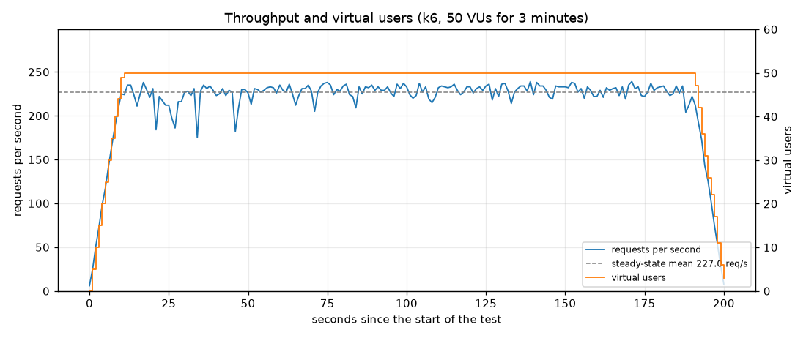
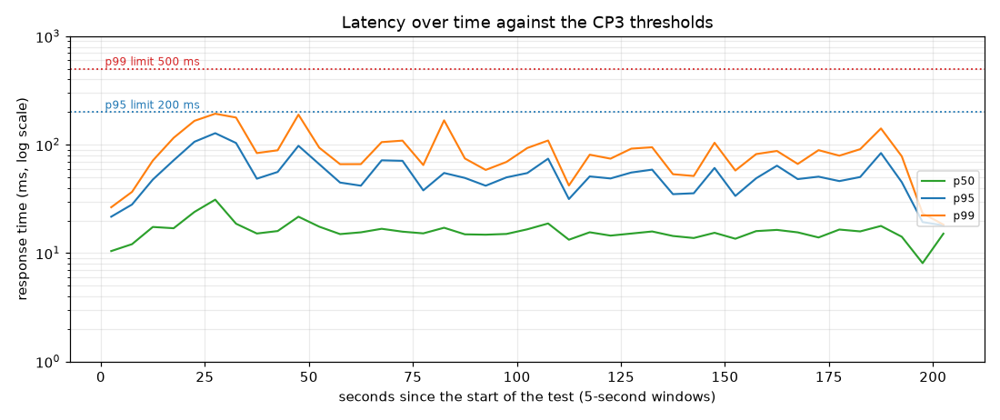
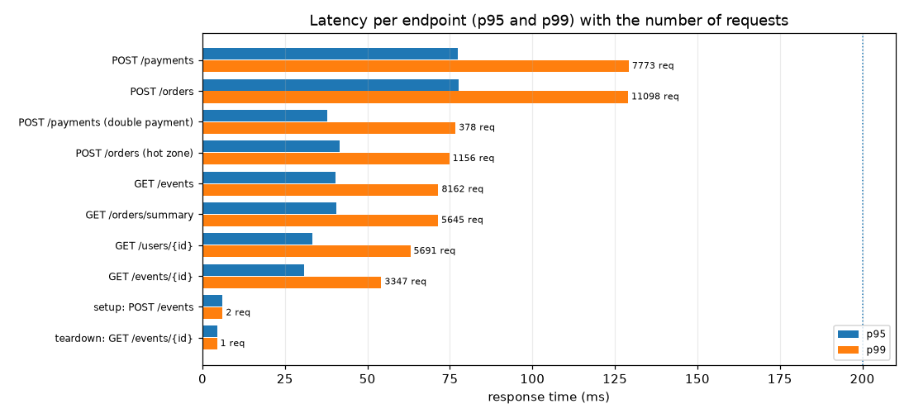
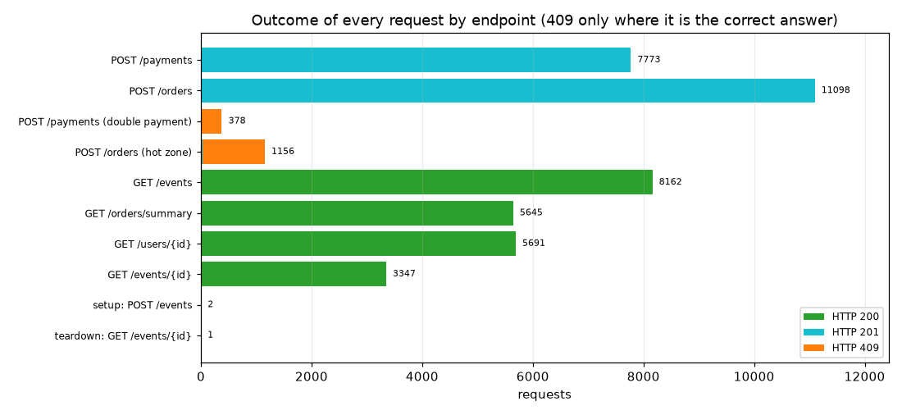

# Checkpoint 3: Performance Audit Report

## 1. Executive Summary

This report presents the architectural evaluation, concurrency integrity verification, and automated load benchmarking conducted for **Checkpoint 3 (CP3)**. The evaluation audited the production readiness of our Web API backend under sustained concurrent read/write stress.

Key achievements verified during this audit include:
- **Zero Race Conditions**: Under high parallel purchase contention, concurrency control mechanisms guaranteed that shared inventory was never oversold (zero lost updates). The same guarantee holds *inside* the load test: 50 VUs fought for the 25 seats of a contested zone and **exactly 25 orders won** (1,131 received HTTP 409).
- **$O(1)$ Query Performance**: Elimination of $N+1$ query loops across list endpoints via explicit query projection (explicit column projections and aggregation, no entity graphs). The number of SQL round trips does not change when the data grows 50 to 300 times.
- **Verified Load Benchmark with Real Writes**: A 3-minute sustained load test with **50 Virtual Users (VUs)** yielded **216.1 Requests Per Second (RPS)**, a $p95$ response latency of **60.04 ms** (target $< 200\text{ ms}$), a $p99$ response latency of **104.07 ms** (target $< 500\text{ ms}$), and an HTTP error rate of **0.00%** (0 of 43,253 requests, target $< 1\%$). Every write succeeded: **11,098 orders** and **7,773 payments** were committed during the run, and the result was reproduced in three consecutive runs.
- **Data Integrity After Load**: The consistency audit (13 invariants across PostgreSQL and MongoDB) passed after the benchmark: 0 double charges, 0 oversold seats, 0 drift between the two databases.

---

## 2. Load Test & Performance (k6 Benchmark)

The automated benchmark was conducted against the Nginx ingress gateway reverse-proxying into dual FastAPI backend worker instances (`ticweb_api_1`, `ticweb_api_2`) backed by PostgreSQL 15 and MongoDB 6.0. The reported run is the third of three identical runs (section 2.4).

### 2.1 Result Against the CP3 Specification

| Metric | CP3 Specification Requirement | Observed Benchmark Value | Audit Status | Note |
| :--- | :--- | :--- | :--- | :--- |
| **Virtual Users (VUs)** | $\ge 50$ concurrent VUs | **50 VUs** | **PASS** | Sustained load testing at 50 concurrent users |
| **Test Duration** | $\ge 3$ minutes at full load | **3m 00s at 50 VUs** (3m 20s with ramps) | **PASS** | 10 s ramp-up, 180 s steady state, 10 s ramp-down |
| **Concurrent Read/Write** | Read and write transactions | **65% read / 35% write** iterations (53% / 47% of the requests); 11,098 orders + 7,773 payments committed | **PASS** | Writes are counted only when the API answered `201` |
| **Throughput (RPS)** | Sustained, stable rate | **216.1 RPS** (43,253 reqs); steady state **227.0 RPS**, min 175, max 239 | **PASS** | Coefficient of variation 4.4% over 176 steady-state seconds |
| **Latency ($p95$)** | $p95 < 200\text{ ms}$ | **60.04 ms** | **PASS** | $\approx 3.3\times$ faster than requirement |
| **Latency ($p99$)** | $p99 < 500\text{ ms}$ | **104.07 ms** (Max: 273.98 ms) | **PASS** | $\approx 4.8\times$ headroom; no request slower than 500 ms |
| **HTTP Error Rate** | Rate $< 1.00\%$ | **0.00%** (0 failed / 43,253 requests) | **PASS** | k6's own `http_req_failed`: every status other than the expected one is a failure |

Tail check on the raw data: 29 of 43,253 requests (0.07%) took longer than 200 ms and none took longer than 500 ms. In the worst 5-second window the $p99$ was 193 ms; no window exceeded the 200 ms $p95$ limit (worst window $p95$: 128 ms).

### 2.2 Outcome and Latency by Operation

| Operation | Requests | $p50$ | $p95$ | $p99$ | Max | Answers (all expected) |
| :--- | ---: | ---: | ---: | ---: | ---: | :--- |
| `GET /events` | 8,162 | 8.9 ms | 40.2 ms | 71.5 ms | 156.7 ms | 200 × 8,162 |
| `GET /events/{id}` | 3,347 | 5.7 ms | 30.8 ms | 54.2 ms | 120.6 ms | 200 × 3,347 |
| `GET /users/{id}` | 5,691 | 7.2 ms | 33.2 ms | 63.0 ms | 158.6 ms | 200 × 5,691 |
| `GET /orders/summary` | 5,645 | 10.9 ms | 40.6 ms | 71.4 ms | 133.8 ms | 200 × 5,645 |
| `POST /orders` | 11,098 | 21.2 ms | 77.6 ms | 129.0 ms | 239.1 ms | **201 × 11,098** |
| `POST /payments` | 7,773 | 23.9 ms | 77.4 ms | 129.2 ms | 274.0 ms | **201 × 7,773** |
| `POST /orders` (contested hot zone) | 1,156 | 8.6 ms | 41.5 ms | 74.8 ms | 127.0 ms | 201 × 25, 409 × 1,131 |
| `POST /payments` (deliberate double payment) | 378 | 9.2 ms | 37.7 ms | 76.7 ms | 147.4 ms | 409 × 378 |

### 2.3 Charts



*Figure 1. Requests per second and virtual users over the whole test. After the 10-second ramp the rate holds around 227 RPS; a few one-second dips to about 175-185 RPS occur in the first minute (their cause was not analysed) and none of them touched the latency limits.*



*Figure 2. $p50$, $p95$ and $p99$ per 5-second window (log scale) against the two CP3 limits. Both percentiles stay far below their limits in every window.*



*Figure 3. $p95$ and $p99$ per endpoint. The write endpoints are the slowest (two databases and a row lock), and still below 130 ms at the $p99$.*



*Figure 4. Every status code by endpoint. Orange (409) appears only where it is the correct answer: the contested zone and the deliberate double payment.*

### 2.4 Repeatability

| Run | Requests | RPS | $p95$ | $p99$ | Max | Failed | Orders | Payments | Hot-zone wins |
| :--- | ---: | ---: | ---: | ---: | ---: | ---: | ---: | ---: | ---: |
| 1 | 42,949 | 214.7 | 64.06 ms | 102.40 ms | 268.99 ms | 0 | 11,057 | 7,668 | 25 |
| 2 | 43,094 | 215.4 | 60.57 ms | 103.34 ms | 249.74 ms | 0 | 11,031 | 7,702 | 25 |
| **3 (reported)** | **43,253** | **216.1** | **60.04 ms** | **104.07 ms** | **273.98 ms** | **0** | **11,098** | **7,773** | **25** |

Runs 1 and 2 executed the same script before only the run-command comment in its header was edited.

### 2.5 Independent Cross-Check (Locust)

The reference Locust profile (`docs/perf/reference_locustfile.py`, a different traffic mix that includes `POST /users`) was run for 180 s with 50 users against the same code: 27,708 requests, **154.9 RPS**, $p95$ 120 ms, $p99$ 130 ms, 0 failures. Its aggregate $p95$ is carried by `POST /users` (bcrypt password hashing, $\approx 130\text{ ms}$ per registration, about 5% of that mix); without it the write endpoints stay at $p95 \le 35\text{ ms}$. Both tools agree that the targets hold.

---

## 3. Concurrency Control & Race Condition Prevention (`test_concurrency.py`)

### 3.1 Mechanism (Option B: Pessimistic Concurrency Control)

- **Seat inventory (MongoDB)**: one conditional atomic update per (event, zone) reserves all seats of an order or none of them; a seat can be taken only while `booked_count < capacity`.
- **Seat identity (PostgreSQL)**: a partial unique index on `(event_id, seat_zone, seat_number)` for active tickets makes a double booking of a numbered seat impossible even if the application code is bypassed (seats without a number are protected by the MongoDB counter above). Seats are always inserted in one global order, which removed a PostgreSQL deadlock that had ended 13% to 61% of the opposite-order test rounds in HTTP 500.
- **Payment**: the order row is locked with `SELECT ... FOR UPDATE` inside the transaction, so concurrent payments of one order are serialised. The partial unique index `uq_payments_order_completed` lets the database itself refuse a second completed payment (answered with HTTP 409).
- **Errors**: deadlock, serialization failure and lock timeout are answered with `409`; an exhausted connection pool or a statement timeout with `503` and `Retry-After`. Every wait is bounded (lock 5 s, statement 15 s, pool 5 s) and the MongoDB seats are returned on any failure.

### 3.2 Verification

| Scenario | System Requirement | Observed Value | Audit Status |
| :--- | :--- | :--- | :--- |
| **Aim for the last ticket (20 users)** (`test_last_ticket_20_users`) | Only 1 successful user; all other concurrent requests receive HTTP 409 Conflict | 1 × `201`, 19 × `409`; MongoDB `booked_count` = 1; PostgreSQL holds exactly 1 active ticket | **PASS** |
| **Parallel Payment Processing** (`test_parallel_payments_charge_the_order_once`) | The order is charged exactly once | 1 × `201`, 19 × `409`; the `uq_payments_order_completed` index refuses a second completed payment (`test_db_guards.py`: 8 raw writers, 1 succeeds, 7 refused) | **PASS** |
| **Idempotency Key Replay** | Replaying an identical payload returns the original order without creating a duplicate | Same key sent in parallel creates exactly one order; a different payload under the same key is refused with 409 | **PASS** |
| **Opposite-order multi-seat bookings** | No HTTP 5xx from lock ordering | 0 × 5xx; seats are inserted in one global order | **PASS** |
| **Deadlock / Statement Timeout** | Catch the failure and release pending seat reservations | Deadlock answered `409`, statement timeout `503`; seats returned to MongoDB in both cases | **PASS** |
| **Total Concurrency Suite** | Pass all automated assertions | **22 / 22 Passed** in-process; **17 passed** through Nginx and both replicas (the other 5 only work in-process) | **PASS** |
| **Database Guards Suite** (`test_db_guards.py`) | The database refuses what the code should never do | **20 / 20 Passed** | **PASS** |

### 3.3 The Same Guarantee Under Load (k6)

| Check inside the 50-VU run | Requirement | Observed Value | Audit Status |
| :--- | :--- | :--- | :--- |
| **Contested zone** (25 seats, 1,156 attempts) | Exactly 25 orders win | `hot_zone_orders_won` = **25**, 1,131 × `409`; final `booked_count` = 25 / 25 | **PASS** |
| **Double payment** (378 repeated payments) | Never charged twice | 378 × `409`; 0 orders with two completed payments after the run | **PASS** |

### 3.4 How Our API Maps to the Specification's Sample Script

The sample script in section 3 of the CP3 specification books with `POST /api/v1/tickets/book` and the body `{"event_id": 1, "user_id": i}`, counts `200` as a success and `409` as a conflict, and asserts `successes == 1`. Our API keeps the same contract (one winner, every other user gets `409`) but differs in three details that follow from the data model. The assertion itself is unchanged.

| Specification sample | Our API | Reason |
| :--- | :--- | :--- |
| `POST /api/v1/tickets/book` | `POST /api/v1/orders` | A booking is an **order**: the unit that is held for 10 minutes, paid, expired or cancelled. Its tickets are created by the same request, so there is no separate `/tickets/book` route. |
| Success is `200 OK` | Success is `201 Created` | The request creates a new resource (the order and its tickets), and `201` is the status for that. Replaying the same `Idempotency-Key` creates no second order: the original order is returned (`200` or `201`). |
| Body `{"event_id": 1, "user_id": i}` | Body `{"user_id": i, "items": [{"event_id": "<MongoDB ObjectId>", "seat_zone": "...", "seat_number": "..."}]}` | Events live in MongoDB, so their ids are 24-character ObjectIds, not integers, and the buyer names the zone and, for a numbered seat, the seat. |
| A lost race is `409 Conflict` | A lost race is `409 Conflict` | Identical. A sold-out zone and a taken seat answer `409`, and so do a PostgreSQL deadlock, a serialization failure and a lock timeout caught by the API (`app/core/db_errors.py`). |

`test_last_ticket_20_users` is the specification's example written for these details: 20 threads book an event whose only zone has **one** seat left, and the test asserts `successes == 1` (counting `201`) and `conflicts == 19`. In addition it checks that the MongoDB counter shows exactly one seat taken and that PostgreSQL holds exactly one active ticket for the event.

---

## 4. Query Projection & Elimination of $N+1$ Query Bottlenecks

| Endpoint / Operation | Query Growth (Target) | Total Round Trips (small vs. large data) | Payload Size | Audit Status |
| :--- | :--- | :--- | :--- | :--- |
| **GET /orders/summary** | $O(1)$ Constant SQL | 2 SQL queries (user existence check + one summary `SELECT` with `COUNT` / `SUM`); identical for 1 and 300 orders | 3.8 KB for 300 orders (limit 20) instead of 329 KB | **PASS** |
| **GET /orders?user_id=** (original path) | $O(1)$ Constant SQL | Redirects to the paginated summary: 2 SQL queries for 1 and for 300 orders | 3.8 KB (from 329 KB) | **PASS** |
| **GET /orders/{id}** | $O(1)$ Constant SQL | 1 SQL query (eager join) for 1 or 50 tickets and payments | 21.2 KB for 50 tickets + 50 payments | **PASS** |
| **GET /users** | $O(1)$ Constant SQL | 2 SQL queries (1 count + 1 projected select) for 1 or 100 rows | 24.1 KB per 100 users; `hashed_password` is never selected | **PASS** |
| **GET /events** | $O(1)$ Constant Database Ops | 2 MongoDB operations (count + aggregation pipeline with `$project`) | 27.1 KB per 100 events (from 124 KB) | **PASS** |
| **POST /orders (Booking)** | $O(1)$ Roundtrips per batch | 3 SQL + 3 MongoDB, the same for 1 and for 20 tickets | - | **PASS** |
| **POST /orders/{id}/payments** (and `POST /payments`) | $O(1)$ Roundtrips per batch | 6 SQL + 1 MongoDB for 1 and for 20 tickets (was 11 and 30: one `UPDATE` per ticket) | - | **PASS** |
| **Total Query Count Suite** | Pass all automated query assertions | **20 / 20 Passed** (`tests/test_query_counts.py`, prints this audit table with `-s`) | - | **PASS** |

---

## 5. Automated Load Testing Methodology

### 5.1 Test Configuration (`scripts/k6_script.js`)
The test was executed using **k6 v2.3.0** against an isolated copy of the containerized stack (same `docker-compose.yml`, renamed ports and volumes; Docker Desktop, 16 CPUs, 16 GB; PostgreSQL 15, MongoDB 6.0, Nginx 1.27, Python 3.11 with FastAPI and uvicorn, two API replicas). The load generator ran on the same host.
- **Load Shape**:
  - **Ramp-Up**: 0 to 50 VUs over 10 seconds.
  - **Steady State**: 50 continuous VUs sustained over 3 minutes.
  - **Ramp-Down**: 50 to 0 VUs over 10 seconds.
- **Setup**: the script creates two events of its own, so the run never depends on the seeded data: a zone with 1,000,000 seats (normal traffic, so orders never fail because a zone sold out) and a **contested zone with 25 seats**.
- **Traffic Ratio**:
  - **Read Workload (~65% of the iterations, 53% of the requests)**: `GET /api/v1/events` (35%), `GET /api/v1/events/{id}` (15%), `GET /api/v1/users/{id}` (25%), `GET /api/v1/orders/summary` (25%).
  - **Write Workload (~35% of the iterations, 47% of the requests, because one write iteration sends up to three requests)**: 90% of the writes book one ticket with `POST /api/v1/orders` and 70% of those buyers pay the order that was just returned with `POST /api/v1/payments` (the rest abandon the cart and their hold expires); 5% of the payments are repeated on purpose. The other 10% of the writes try to book the contested zone.
- **What counts as a success**: only the status the operation is meant to return (`200` for reads, `201` for a new order and for a payment). `409` is accepted in exactly two places: the contested zone and the deliberate double payment. Anything else is counted by k6 as a failed request.
- **Thresholds** (the run fails if one is crossed): $p95 < 200\text{ ms}$, $p99 < 500\text{ ms}$, `http_req_failed` $< 1\%$, `http_errors` $< 1\%$, `checks` $> 99\%$, and `hot_zone_orders_won == 25`.

### 5.2 Raw k6 Benchmark Output
```text
time="2026-10-25T03:23:02Z" level=info msg="hot zone after the test: booked_count=25 capacity=25" source=console

  █ THRESHOLDS 

    checks
    ✓ 'rate>0.99' rate=100.00%

    hot_zone_orders_won
    ✓ 'count==25' count=25

    http_errors
    ✓ 'rate<0.01' rate=0.00%

    http_req_duration
    ✓ 'p(95)<200' p(95)=60.04ms
    ✓ 'p(99)<500' p(99)=104.07ms

    http_req_failed
    ✓ 'rate<0.01' rate=0.00%

  █ TOTAL RESULTS 

    checks_total.......: 43251   216.088467/s
    checks_succeeded...: 100.00% 43251 out of 43251
    checks_failed......: 0.00%   0 out of 43251

    ✓ order status 201
    ✓ order summary status 200
    ✓ user status 200
    ✓ payment status 201
    ✓ event detail status 200
    ✓ double payment refused with 409
    ✓ events status 200
    ✓ hot zone order is 201 or 409
    ✓ hot zone sold exactly its capacity (no oversell)

    CUSTOM
    double_payments_rejected.......: 378    1.888545/s
    hot_zone_orders_sold_out.......: 1131   5.650645/s
    hot_zone_orders_won............: 25     0.124904/s
    http_errors....................: 0.00%  0 out of 43250
    orders_created.................: 11098  55.447268/s
    payments_completed.............: 7773   38.835071/s

    HTTP
    http_req_duration..............: avg=20.89ms min=2.95ms   med=15.91ms  max=273.98ms p(90)=41.54ms  p(95)=60.04ms  p(99)=104.07ms
      { expected_response:true }...: avg=20.89ms min=2.95ms   med=15.91ms  max=273.98ms p(90)=41.54ms  p(95)=60.04ms  p(99)=104.07ms
    http_req_failed................: 0.00%  0 out of 43253
    http_reqs......................: 43253  216.098459/s

    EXECUTION
    iteration_duration.............: avg=271ms   min=203.29ms med=214.15ms max=798.83ms p(90)=454.67ms p(95)=479.42ms p(99)=541.33ms
    iterations.....................: 35099  175.359855/s
    vus............................: 3      min=3          max=50
    vus_max........................: 50     min=50         max=50

    NETWORK
    data_received..................: 94 MB  470 kB/s
    data_sent......................: 7.4 MB 37 kB/s
```
`iteration_duration` includes the think times of the script (0.2 s per sleep) and is not a response time.

### 5.3 Methodology Revision
An earlier revision of this benchmark (186.4 RPS, $p95$ 85.82 ms, $p99$ 478.66 ms) is **withdrawn**. Its checks treated `400`, `404`, `409` and `410` as valid answers, and k6's own `http_req_failed` metric showed 34.86% (11,712 of 33,592 requests): every write request had been refused, because the event list no longer carries zones (the list is a summary) and the script fell back to an event id that does not exist, and because it paid random order ids. The figures in this report replace it: the script now creates its own events, pays the order it has just created, counts only the expected status as success, and thresholds on `http_req_failed` itself.

---

## 6. Performance Observations & Analysis

1. **Latency Profile**:
   The median response latency was $15.91\text{ ms}$, with $p90$ at $41.54\text{ ms}$ and $p95$ at $60.04\text{ ms}$. Reads finish at $p99 \le 72\text{ ms}$; writes are the slowest operations ($p99 \approx 129\text{ ms}$ for `POST /orders` and `POST /payments`) because each one takes a row lock and writes to two databases, and they are still $\approx 3.9\times$ below the $500\text{ ms}$ limit.
2. **Tail Latency ($p99$) Stability**:
   The $p99$ latency reached $104.07\text{ ms}$ (against a ceiling of $500\text{ ms}$) and the slowest request of the whole run took $273.98\text{ ms}$. Under contention the system stays fast: the 1,131 refused bookings of the contested zone were answered in $p99 = 74.8\text{ ms}$, because a sold-out zone is rejected by one conditional update before any PostgreSQL row is written.
3. **Throughput Stability**:
   After the ramp-up the rate stayed between 175 and 239 RPS (mean 227.0, coefficient of variation 4.4%); there is no drift or decay over the 180 seconds, only a few short dips in the first minute (Figure 1).
4. **Resource Utilization**:
   Both FastAPI workers shared the load through Nginx round-robin balancing. After the three runs the replica logs contained no errors, the Nginx error log was empty, no request was answered `503` (no connection pool exhaustion), and the outbox was fully drained (0 pending of 61,690 events). Resident memory afterwards: 76 MiB and 75 MiB per replica, 150 MiB PostgreSQL, 135 MiB MongoDB, 13 MiB Nginx (sampled after the runs, not a peak).

---

## 7. Consistency Audit After the Load

`scripts/verify_consistency.py` was run after the benchmark (the database then held 34,415 orders, seeded ones included, written by three full runs and two smoke runs; 23,932 of them were confirmed, with exactly 23,932 completed payments):

```text
[consistency] PostgreSQL vs MongoDB audit
  PASS  duplicate_active_seats           0
  PASS  double_charged_orders            0
  PASS  confirmed_without_payment        0
  PASS  payment_amount_mismatch          0
  PASS  order_total_mismatch             0
  PASS  dead_order_with_active_tickets   0
  PASS  ticket_state_mismatch            0
  PASS  negative_booked_count            0
  PASS  mongo_over_capacity              0
  PASS  pg_over_capacity                 0
  PASS  drift_mongo_below_pg             0
  PASS  drift_mongo_above_pg             0
  PASS  tickets_for_unknown_zone         0
[consistency] ALL CHECKS PASSED
```

---

## 8. Risks & Limitations

- **Shared host**: k6 and the whole stack ran on one machine (16 CPUs), so absolute numbers are optimistic compared with a separate load generator; the pass/fail margins are large (3.3× on $p95$, 4.8× on $p99$).
- **Synthetic events**: the normal traffic books a dedicated 1,000,000-seat zone so that writes keep succeeding for three minutes; the realistic scarce-inventory case is covered by the 25-seat contested zone and by `test_concurrency.py`.
- **Registration excluded**: `POST /users` (bcrypt, $\approx 130\text{ ms}$) is not in the k6 mix; in the Locust cross-check it carries the aggregate $p95$. Report it separately if registration traffic is part of a scenario.
- **Abandoned carts**: 30% of the buyers do not pay; their holds (6,704 pending orders at the end) expire after 10 minutes and are released by the background sweeper in batches, which is outside the 3-minute window.
- **Small data set**: the seeded database has 250 users. Effects of very large tables were measured separately (index review, `docs/perf/index_review.md`).
- **Single node databases**: fail-over of PostgreSQL or MongoDB is not part of this benchmark; the behaviour during outages is documented in `docs/perf/resilience_results.md`.

---

## 9. How to Reproduce

```bash
docker compose up -d --build
docker compose exec api python seed.py

# concurrency, query counts and database guards (in-process, then through Nginx and both replicas)
docker compose exec -e REQUIRE_DB=1 api pytest tests/test_concurrency.py tests/test_query_counts.py tests/test_db_guards.py -v
docker compose exec -e API_URL=http://nginx -e REQUIRE_DB=1 api pytest tests/test_concurrency.py -v

# the load test: 50 VUs, 3 minutes (summary in docs/k6_summary.json, raw points in docs/perf/k6_points.csv)
docker run --rm --network 269340-pruet_ticweb_default -v "$PWD/scripts:/scripts:ro" -v "$PWD/docs:/out" \
  -e BASE_URL=http://nginx/api/v1 grafana/k6 run /scripts/k6_script.js \
  --summary-export /out/k6_summary.json --out csv=/out/perf/k6_points.csv

# charts and per-endpoint numbers from the raw points
docker run --rm -v "$PWD/docs/perf:/out" python:3.11-slim python /out/make_k6_charts.py

# integrity after the load
docker compose exec api python scripts/verify_consistency.py
```

---
